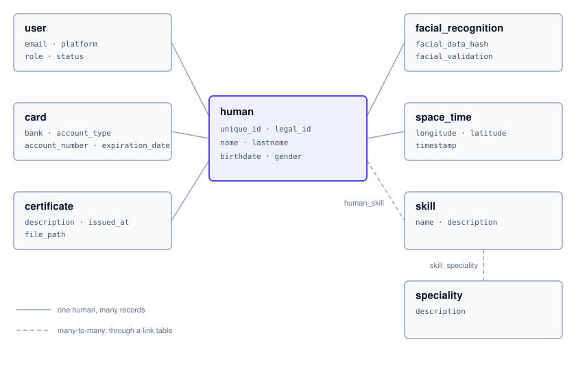

# Thruxion - Humans API

API URL: https://thruxion.com/api/humans/

The Humans API keeps a registry of people (humans) and what is known about them: their user accounts on different platforms, their skills and specialities, certificates, facial recognition records, bank cards and space-time records (where they were, and when). A human is the central record and everything else belongs to one.



The documentation has code examples in Shell, Ruby, Python and JavaScript. The JavaScript examples run on Node.js with the `axios` package, plus `form-data` for file uploads.

Conventions used by every endpoint:

* Requests and responses are JSON. File uploads use `multipart/form-data`.
* Every endpoint except [System Login](#system-login) and [Health Check](#health-check) needs a token in the `Authorization` header, as `Bearer <token>`.
* IDs are integers.
* Send dates as `YYYY-MM-DD` and date-times as `YYYY-MM-DD HH:MM:SS`. Responses return them in ISO 8601 format (UTC), for example `2026-01-13T00:40:56.000Z`.

# Authentication

The API uses JSON Web Tokens (JWT). Log in with a system account to get a token, then include it in the `Authorization` header of every other request:

`Authorization: Bearer <token>`

There are two system accounts, **admin** and **dev**, and their credentials are provided by Thruxion. They are different from the [users](#users) stored by the API, who are the end users of your platforms.

<aside class="notice">
Every endpoint currently requires a token from the <strong>admin</strong> account. Tokens from the dev account are refused with <code>403</code>.
</aside>

A request with a missing or rejected token gets one of these errors:

Status | Body | Reason
------ | ---- | ------
401 | `{"error": "Access denied"}` | No Authorization header.
401 | `{"error": "Invalid Authorization format"}` | The header is not `Bearer <token>`.
403 | `{"error": "Invalid token"}` | The token is invalid, expired or from the wrong account.

## System Login

```ruby
require 'net/http'
require 'json'

uri = URI('https://thruxion.com/api/humans/auth/system-login')
req = Net::HTTP::Post.new(uri, 'Content-Type' => 'application/json')
req.body = {
  username: 'admin',
  password: 'yourpassword'
}.to_json

res = Net::HTTP.start(uri.hostname, uri.port, use_ssl: true) { |http| http.request(req) }
puts res.body
```

```python
import requests

url = "https://thruxion.com/api/humans/auth/system-login"
data = {
    "username": "admin",
    "password": "yourpassword"
}

response = requests.post(url, json=data)
print(response.json())
```

```shell
curl -X POST "https://thruxion.com/api/humans/auth/system-login" \
  -H "Content-Type: application/json" \
  -d '{
    "username": "admin",
    "password": "yourpassword"
  }'
```

```javascript
const axios = require('axios');

const login = async () => {
    const data = {
        username: 'admin',
        password: 'yourpassword'
    };
    try {
        const response = await axios.post('https://thruxion.com/api/humans/auth/system-login', data);
        console.log(response.data);
    } catch (error) {
        console.error(error.response ? error.response.data : error.message);
    }
};

login();
```

> The above command returns JSON structured like this:

```json
{
    "token": "eyJhbGciOiJIUzI1NiIsInR5cCI6IkpXVCJ9...",
    "role": "admin"
}
```

This endpoint logs in with a system account and returns a token. `role` says which account the token belongs to: `admin` or `dev`.

### HTTP Request

`POST https://thruxion.com/api/humans/auth/system-login`

### Parameters

Parameter | In | Type | Required | Description
--------- | -- | ---- | -------- | -----------
username | body | string | Yes | The system account's username.
password | body | string | Yes | The system account's password.

Wrong credentials get `401` with `{"error": "Invalid credentials"}`.

<aside class="notice">
The token expires after 2 hours. Log in again to get a new one.
</aside>

# Humans

A human is the central record of the API. Users, certificates, facial recognition records, cards, space-time records and skill links all belong to a human.

## Create Human

```ruby
require 'net/http'
require 'json'

uri = URI('https://thruxion.com/api/humans/human')
req = Net::HTTP::Post.new(uri, 'Content-Type' => 'application/json', 'Authorization' => 'Bearer YOUR_JWT_TOKEN')
req.body = {
  unique_id: 'HUM-000123',
  legal_id: '12345678-9',
  name: 'Ana',
  lastname: 'Rojas',
  birthdate: '1990-05-14',
  gender: 'female'
}.to_json

res = Net::HTTP.start(uri.hostname, uri.port, use_ssl: true) { |http| http.request(req) }
puts res.body
```

```python
import requests

url = "https://thruxion.com/api/humans/human"
headers = {"Authorization": "Bearer YOUR_JWT_TOKEN"}
data = {
    "unique_id": "HUM-000123",
    "legal_id": "12345678-9",
    "name": "Ana",
    "lastname": "Rojas",
    "birthdate": "1990-05-14",
    "gender": "female"
}

response = requests.post(url, headers=headers, json=data)
print(response.json())
```

```shell
curl -X POST "https://thruxion.com/api/humans/human" \
  -H "Authorization: Bearer YOUR_JWT_TOKEN" \
  -H "Content-Type: application/json" \
  -d '{
    "unique_id": "HUM-000123",
    "legal_id": "12345678-9",
    "name": "Ana",
    "lastname": "Rojas",
    "birthdate": "1990-05-14",
    "gender": "female"
  }'
```

```javascript
const axios = require('axios');

const createHuman = async (token) => {
    const data = {
        unique_id: 'HUM-000123',
        legal_id: '12345678-9',
        name: 'Ana',
        lastname: 'Rojas',
        birthdate: '1990-05-14',
        gender: 'female'
    };
    try {
        const response = await axios.post('https://thruxion.com/api/humans/human', data, {
            headers: { Authorization: `Bearer ${token}` }
        });
        console.log(response.data);
    } catch (error) {
        console.error(error.response ? error.response.data : error.message);
    }
};

createHuman('YOUR_JWT_TOKEN');
```

> The above command returns JSON structured like this:

```json
{
    "success": true,
    "message": "Human created",
    "id": 1
}
```

This endpoint creates a human. It answers `201 Created` with the new human's ID.

### HTTP Request

`POST https://thruxion.com/api/humans/human`

### Parameters

Parameter | In | Type | Required | Description
--------- | -- | ---- | -------- | -----------
unique_id | body | string | No | Your own identifier for the human. Must be unique.
legal_id | body | string | No | National ID or another legal identifier.
name | body | string | Yes | First name, up to 100 characters.
lastname | body | string | Yes | Last name, up to 100 characters.
birthdate | body | date | Yes | Date of birth, `YYYY-MM-DD`.
gender | body | string | Yes | Up to 50 characters.

<aside class="notice">
Requires an admin token from <a href='#system-login'>System Login</a> in the Authorization header as Bearer.
</aside>

## List Humans

```ruby
require 'net/http'
require 'json'

uri = URI('https://thruxion.com/api/humans/human')
uri.query = URI.encode_www_form(page: 1, limit: 20)
req = Net::HTTP::Get.new(uri, 'Authorization' => 'Bearer YOUR_JWT_TOKEN')

res = Net::HTTP.start(uri.hostname, uri.port, use_ssl: true) { |http| http.request(req) }
puts res.body
```

```python
import requests

url = "https://thruxion.com/api/humans/human"
headers = {"Authorization": "Bearer YOUR_JWT_TOKEN"}
params = {
    "page": 1,
    "limit": 20
}

response = requests.get(url, headers=headers, params=params)
print(response.json())
```

```shell
curl "https://thruxion.com/api/humans/human?page=1&limit=20" \
  -H "Authorization: Bearer YOUR_JWT_TOKEN"
```

```javascript
const axios = require('axios');

const listHumans = async (token) => {
    try {
        const response = await axios.get('https://thruxion.com/api/humans/human', {
            headers: { Authorization: `Bearer ${token}` },
            params: { page: 1, limit: 20 }
        });
        console.log(response.data);
    } catch (error) {
        console.error(error.response ? error.response.data : error.message);
    }
};

listHumans('YOUR_JWT_TOKEN');
```

> The above command returns JSON structured like this:

```json
{
    "success": true,
    "page": 1,
    "limit": 20,
    "count": 1,
    "data": [
        {
            "id": 1,
            "unique_id": "HUM-000123",
            "legal_id": "12345678-9",
            "name": "Ana",
            "lastname": "Rojas",
            "birthdate": "1990-05-14T00:00:00.000Z",
            "gender": "female",
            "created_at": "2026-01-13T00:40:56.000Z",
            "updated_at": "2026-01-13T00:40:56.000Z"
        }
    ]
}
```

This endpoint lists humans, newest first, one page at a time. `count` is the number of humans on this page.

### HTTP Request

`GET https://thruxion.com/api/humans/human`

### Parameters

Parameter | In | Type | Required | Description
--------- | -- | ---- | -------- | -----------
page | query | integer | No | Page number, starting at 1. Default: 1.
limit | query | integer | No | Humans per page, from 1 to 100. Default: 50.

<aside class="notice">
Requires an admin token from <a href='#system-login'>System Login</a> in the Authorization header as Bearer.
</aside>

## Get Human

```ruby
require 'net/http'
require 'json'

human_id = 1  # Replace 1 with the human ID
uri = URI("https://thruxion.com/api/humans/human/#{human_id}")
req = Net::HTTP::Get.new(uri, 'Authorization' => 'Bearer YOUR_JWT_TOKEN')

res = Net::HTTP.start(uri.hostname, uri.port, use_ssl: true) { |http| http.request(req) }
puts res.body
```

```python
import requests

human_id = 1  # Replace 1 with the human ID
url = f"https://thruxion.com/api/humans/human/{human_id}"
headers = {"Authorization": "Bearer YOUR_JWT_TOKEN"}

response = requests.get(url, headers=headers)
print(response.json())
```

```shell
curl "https://thruxion.com/api/humans/human/1" \
  -H "Authorization: Bearer YOUR_JWT_TOKEN"
```

```javascript
const axios = require('axios');

const getHuman = async (id, token) => {
    try {
        const response = await axios.get(`https://thruxion.com/api/humans/human/${id}`, {
            headers: { Authorization: `Bearer ${token}` }
        });
        console.log(response.data);
    } catch (error) {
        console.error(error.response ? error.response.data : error.message);
    }
};

// Replace 1 with the human ID
getHuman(1, 'YOUR_JWT_TOKEN');
```

> The above command returns JSON structured like this:

```json
{
    "success": true,
    "data": {
        "id": 1,
        "unique_id": "HUM-000123",
        "legal_id": "12345678-9",
        "name": "Ana",
        "lastname": "Rojas",
        "birthdate": "1990-05-14T00:00:00.000Z",
        "gender": "female",
        "created_at": "2026-01-13T00:40:56.000Z",
        "updated_at": "2026-01-13T00:40:56.000Z",
        "users": [
            {
                "id": 1,
                "email": "ana@example.com",
                "role": "user",
                "status": "active",
                "platform": "android",
                "last_login": "2026-01-14T09:12:03.000Z",
                "created_at": "2026-01-13T00:40:56.000Z"
            }
        ],
        "skills": [
            {
                "id": 3,
                "name": "Welding",
                "description": "MIG and TIG welding"
            }
        ],
        "certificates": [
            {
                "id": 1,
                "description": "Welding certificate",
                "file_path": "uploads/files/file-1736726456123-482910345.pdf",
                "issued_at": "2025-11-20T00:00:00.000Z",
                "created_at": "2026-01-13T00:40:56.000Z"
            }
        ],
        "facial_recognitions": [
            {
                "id": 1,
                "facial_data_hash": "9f86d081884c7d659a2feaa0c55ad015a3bf4f1b2b0b822cd15d6c15b0f00a08",
                "facial_validation": 0,
                "created_at": "2026-01-13T00:40:56.000Z"
            }
        ],
        "cards": [
            {
                "id": 1,
                "bank": "Example Bank",
                "account_type": "checking",
                "expiration_date": "2029-08-31T00:00:00.000Z",
                "created_at": "2026-01-13T00:40:56.000Z"
            }
        ],
        "space_time": [
            {
                "id": 1,
                "longitude": "-70.6483",
                "latitude": "-33.4569",
                "timestamp": "2026-01-13T12:00:00.000Z"
            }
        ]
    }
}
```

This endpoint retrieves one human together with everything that belongs to them: users, skills, certificates, facial recognition records, cards (without account numbers) and the 50 most recent space-time records.

### HTTP Request

`GET https://thruxion.com/api/humans/human/<ID>`

### Parameters

Parameter | In | Type | Required | Description
--------- | -- | ---- | -------- | -----------
ID | path | integer | Yes | The human ID

If no human has that ID, the answer is `404` with `{"success": false, "message": "Human not found"}`.

<aside class="notice">
Requires an admin token from <a href='#system-login'>System Login</a> in the Authorization header as Bearer.
</aside>

## Update Human

```ruby
require 'net/http'
require 'json'

human_id = 1  # Replace 1 with the human ID
uri = URI("https://thruxion.com/api/humans/human/#{human_id}")
req = Net::HTTP::Put.new(uri, 'Content-Type' => 'application/json', 'Authorization' => 'Bearer YOUR_JWT_TOKEN')
req.body = {
  lastname: 'Rojas Soto',
  gender: 'female'
}.to_json

res = Net::HTTP.start(uri.hostname, uri.port, use_ssl: true) { |http| http.request(req) }
puts res.body
```

```python
import requests

human_id = 1  # Replace 1 with the human ID
url = f"https://thruxion.com/api/humans/human/{human_id}"
headers = {"Authorization": "Bearer YOUR_JWT_TOKEN"}
data = {
    "lastname": "Rojas Soto",
    "gender": "female"
}

response = requests.put(url, headers=headers, json=data)
print(response.json())
```

```shell
curl -X PUT "https://thruxion.com/api/humans/human/1" \
  -H "Authorization: Bearer YOUR_JWT_TOKEN" \
  -H "Content-Type: application/json" \
  -d '{
    "lastname": "Rojas Soto",
    "gender": "female"
  }'
```

```javascript
const axios = require('axios');

const updateHuman = async (id, token) => {
    const data = {
        lastname: 'Rojas Soto',
        gender: 'female'
    };
    try {
        const response = await axios.put(`https://thruxion.com/api/humans/human/${id}`, data, {
            headers: { Authorization: `Bearer ${token}` }
        });
        console.log(response.data);
    } catch (error) {
        console.error(error.response ? error.response.data : error.message);
    }
};

// Replace 1 with the human ID
updateHuman(1, 'YOUR_JWT_TOKEN');
```

> The above command returns JSON structured like this:

```json
{
    "success": true,
    "message": "Human updated"
}
```

This endpoint updates a human. Send only the fields you want to change; the others keep their values. A request with no fields is refused with `400`.

### HTTP Request

`PUT https://thruxion.com/api/humans/human/<ID>`

### Parameters

Parameter | In | Type | Required | Description
--------- | -- | ---- | -------- | -----------
ID | path | integer | Yes | The human ID
unique_id | body | string | No | Your own identifier for the human. Must be unique.
legal_id | body | string | No | National ID or another legal identifier.
name | body | string | No | First name.
lastname | body | string | No | Last name.
birthdate | body | date | No | Date of birth, `YYYY-MM-DD`.
gender | body | string | No | Gender.

<aside class="notice">
Requires an admin token from <a href='#system-login'>System Login</a> in the Authorization header as Bearer.
</aside>

## Delete Human

```ruby
require 'net/http'
require 'json'

human_id = 1  # Replace 1 with the human ID
uri = URI("https://thruxion.com/api/humans/human/#{human_id}")
req = Net::HTTP::Delete.new(uri, 'Authorization' => 'Bearer YOUR_JWT_TOKEN')

res = Net::HTTP.start(uri.hostname, uri.port, use_ssl: true) { |http| http.request(req) }
puts res.body
```

```python
import requests

human_id = 1  # Replace 1 with the human ID
url = f"https://thruxion.com/api/humans/human/{human_id}"
headers = {"Authorization": "Bearer YOUR_JWT_TOKEN"}

response = requests.delete(url, headers=headers)
print(response.json())
```

```shell
curl -X DELETE "https://thruxion.com/api/humans/human/1" \
  -H "Authorization: Bearer YOUR_JWT_TOKEN"
```

```javascript
const axios = require('axios');

const deleteHuman = async (id, token) => {
    try {
        const response = await axios.delete(`https://thruxion.com/api/humans/human/${id}`, {
            headers: { Authorization: `Bearer ${token}` }
        });
        console.log(response.data);
    } catch (error) {
        console.error(error.response ? error.response.data : error.message);
    }
};

// Replace 1 with the human ID
deleteHuman(1, 'YOUR_JWT_TOKEN');
```

> The above command returns JSON structured like this:

```json
{
    "success": true,
    "message": "Human deleted"
}
```

This endpoint deletes a human, together with their users, certificates, facial recognition records, cards, space-time records and skill links.

### HTTP Request

`DELETE https://thruxion.com/api/humans/human/<ID>`

### Parameters

Parameter | In | Type | Required | Description
--------- | -- | ---- | -------- | -----------
ID | path | integer | Yes | The human ID

<aside class="notice">
Requires an admin token from <a href='#system-login'>System Login</a> in the Authorization header as Bearer.
</aside>

<aside class="warning">
This cannot be undone.
</aside>

# Users

A user is an account that a human has on one of your platforms, such as a mobile app or a website. The same email can be registered once per platform.

## Register User

```ruby
require 'net/http'
require 'json'

uri = URI('https://thruxion.com/api/humans/user/register')
req = Net::HTTP::Post.new(uri, 'Content-Type' => 'application/json', 'Authorization' => 'Bearer YOUR_JWT_TOKEN')
req.body = {
  human_id: 1,
  email: 'ana@example.com',
  password: 'a-strong-password',
  platform: 'android'
}.to_json

res = Net::HTTP.start(uri.hostname, uri.port, use_ssl: true) { |http| http.request(req) }
puts res.body
```

```python
import requests

url = "https://thruxion.com/api/humans/user/register"
headers = {"Authorization": "Bearer YOUR_JWT_TOKEN"}
data = {
    "human_id": 1,
    "email": "ana@example.com",
    "password": "a-strong-password",
    "platform": "android"
}

response = requests.post(url, headers=headers, json=data)
print(response.json())
```

```shell
curl -X POST "https://thruxion.com/api/humans/user/register" \
  -H "Authorization: Bearer YOUR_JWT_TOKEN" \
  -H "Content-Type: application/json" \
  -d '{
    "human_id": 1,
    "email": "ana@example.com",
    "password": "a-strong-password",
    "platform": "android"
  }'
```

```javascript
const axios = require('axios');

const registerUser = async (token) => {
    const data = {
        human_id: 1,
        email: 'ana@example.com',
        password: 'a-strong-password',
        platform: 'android'
    };
    try {
        const response = await axios.post('https://thruxion.com/api/humans/user/register', data, {
            headers: { Authorization: `Bearer ${token}` }
        });
        console.log(response.data);
    } catch (error) {
        console.error(error.response ? error.response.data : error.message);
    }
};

registerUser('YOUR_JWT_TOKEN');
```

> The above command returns JSON structured like this:

```json
{
    "message": "User created",
    "user_id": 1,
    "platform": "android"
}
```

This endpoint creates a user for an existing human. It answers `201 Created`.

### HTTP Request

`POST https://thruxion.com/api/humans/user/register`

### Parameters

Parameter | In | Type | Required | Description
--------- | -- | ---- | -------- | -----------
human_id | body | integer | Yes | The human this account belongs to.
email | body | string | Yes | A valid email address. It is stored in lowercase.
password | body | string | Yes | At least 6 characters. It is stored as a bcrypt hash.
platform | body | string | No | The platform the account is for, for example `android` or `web`.

Status | Reason
------ | ------
404 | `{"error": "Human not found"}`
409 | `{"error": "Email and platform combination already registered"}`

<aside class="notice">
Requires an admin token from <a href='#system-login'>System Login</a> in the Authorization header as Bearer.
</aside>

## Validate User Login

```ruby
require 'net/http'
require 'json'

uri = URI('https://thruxion.com/api/humans/user/login')
req = Net::HTTP::Post.new(uri, 'Content-Type' => 'application/json', 'Authorization' => 'Bearer YOUR_JWT_TOKEN')
req.body = {
  email: 'ana@example.com',
  password: 'a-strong-password',
  platform: 'android'
}.to_json

res = Net::HTTP.start(uri.hostname, uri.port, use_ssl: true) { |http| http.request(req) }
puts res.body
```

```python
import requests

url = "https://thruxion.com/api/humans/user/login"
headers = {"Authorization": "Bearer YOUR_JWT_TOKEN"}
data = {
    "email": "ana@example.com",
    "password": "a-strong-password",
    "platform": "android"
}

response = requests.post(url, headers=headers, json=data)
print(response.json())
```

```shell
curl -X POST "https://thruxion.com/api/humans/user/login" \
  -H "Authorization: Bearer YOUR_JWT_TOKEN" \
  -H "Content-Type: application/json" \
  -d '{
    "email": "ana@example.com",
    "password": "a-strong-password",
    "platform": "android"
  }'
```

```javascript
const axios = require('axios');

const validateLogin = async (token) => {
    const data = {
        email: 'ana@example.com',
        password: 'a-strong-password',
        platform: 'android'
    };
    try {
        const response = await axios.post('https://thruxion.com/api/humans/user/login', data, {
            headers: { Authorization: `Bearer ${token}` }
        });
        console.log(response.data);
    } catch (error) {
        console.error(error.response ? error.response.data : error.message);
    }
};

validateLogin('YOUR_JWT_TOKEN');
```

> The above command returns JSON structured like this:

```json
{
    "success": true,
    "message": "Login successful",
    "user": {
        "id": 1,
        "human_id": 1,
        "email": "ana@example.com",
        "role": "user",
        "platform": "android"
    }
}
```

This endpoint checks a user's email and password and returns their profile. Send the same `platform` the user registered with (or leave it out if they registered without one).

### HTTP Request

`POST https://thruxion.com/api/humans/user/login`

### Parameters

Parameter | In | Type | Required | Description
--------- | -- | ---- | -------- | -----------
email | body | string | Yes | The user's email.
password | body | string | Yes | The user's password.
platform | body | string | No | The platform the user registered with.

Status | Reason
------ | ------
401 | `{"success": false, "message": "Invalid credentials"}`
403 | `{"success": false, "message": "Account inactive"}`
429 | `{"error": "Too many login attempts. Try again later."}`: more than 20 attempts in 15 minutes.

<aside class="notice">
Requires an admin token from <a href='#system-login'>System Login</a> in the Authorization header as Bearer.
</aside>

<aside class="notice">
This endpoint only checks the credentials. It does not issue a token for the user.
</aside>

## Change User Password

```ruby
require 'net/http'
require 'json'

user_id = 1  # Replace 1 with the user ID
uri = URI("https://thruxion.com/api/humans/user/#{user_id}/change-password")
req = Net::HTTP::Post.new(uri, 'Content-Type' => 'application/json', 'Authorization' => 'Bearer YOUR_JWT_TOKEN')
req.body = {
  current_password: 'a-strong-password',
  new_password: 'an-even-stronger-password'
}.to_json

res = Net::HTTP.start(uri.hostname, uri.port, use_ssl: true) { |http| http.request(req) }
puts res.body
```

```python
import requests

user_id = 1  # Replace 1 with the user ID
url = f"https://thruxion.com/api/humans/user/{user_id}/change-password"
headers = {"Authorization": "Bearer YOUR_JWT_TOKEN"}
data = {
    "current_password": "a-strong-password",
    "new_password": "an-even-stronger-password"
}

response = requests.post(url, headers=headers, json=data)
print(response.json())
```

```shell
curl -X POST "https://thruxion.com/api/humans/user/1/change-password" \
  -H "Authorization: Bearer YOUR_JWT_TOKEN" \
  -H "Content-Type: application/json" \
  -d '{
    "current_password": "a-strong-password",
    "new_password": "an-even-stronger-password"
  }'
```

```javascript
const axios = require('axios');

const changePassword = async (id, token) => {
    const data = {
        current_password: 'a-strong-password',
        new_password: 'an-even-stronger-password'
    };
    try {
        const response = await axios.post(`https://thruxion.com/api/humans/user/${id}/change-password`, data, {
            headers: { Authorization: `Bearer ${token}` }
        });
        console.log(response.data);
    } catch (error) {
        console.error(error.response ? error.response.data : error.message);
    }
};

// Replace 1 with the user ID
changePassword(1, 'YOUR_JWT_TOKEN');
```

> The above command returns JSON structured like this:

```json
{
    "message": "Password updated"
}
```

This endpoint changes a user's password. The current password must be correct.

### HTTP Request

`POST https://thruxion.com/api/humans/user/<ID>/change-password`

### Parameters

Parameter | In | Type | Required | Description
--------- | -- | ---- | -------- | -----------
ID | path | integer | Yes | The user ID
current_password | body | string | Yes | The user's current password.
new_password | body | string | Yes | The new password, at least 6 characters.

Status | Reason
------ | ------
401 | `{"error": "Current password incorrect"}`
404 | `{"error": "User not found"}`

<aside class="notice">
Requires an admin token from <a href='#system-login'>System Login</a> in the Authorization header as Bearer.
</aside>

## Get Current User

```ruby
require 'net/http'
require 'json'

uri = URI('https://thruxion.com/api/humans/user/me')
req = Net::HTTP::Get.new(uri, 'Authorization' => 'Bearer YOUR_USER_TOKEN')

res = Net::HTTP.start(uri.hostname, uri.port, use_ssl: true) { |http| http.request(req) }
puts res.body
```

```python
import requests

url = "https://thruxion.com/api/humans/user/me"
headers = {"Authorization": "Bearer YOUR_USER_TOKEN"}

response = requests.get(url, headers=headers)
print(response.json())
```

```shell
curl "https://thruxion.com/api/humans/user/me" \
  -H "Authorization: Bearer YOUR_USER_TOKEN"
```

```javascript
const axios = require('axios');

const getCurrentUser = async (token) => {
    try {
        const response = await axios.get('https://thruxion.com/api/humans/user/me', {
            headers: { Authorization: `Bearer ${token}` }
        });
        console.log(response.data);
    } catch (error) {
        console.error(error.response ? error.response.data : error.message);
    }
};

getCurrentUser('YOUR_USER_TOKEN');
```

> The above command returns JSON structured like this:

```json
{
    "id": 1,
    "email": "ana@example.com",
    "role": "user",
    "status": "active",
    "platform": "android",
    "created_at": "2026-01-13T00:40:56.000Z",
    "human_id": 1,
    "name": "Ana",
    "lastname": "Rojas"
}
```

<aside class="warning">
This endpoint is temporarily unavailable: requests currently get no response. It is documented as it will work once the fix is released. It also needs a user token, which the API does not issue yet.
</aside>

This endpoint returns the logged-in user's account and the name of their human. It needs a token issued to the user, not a system token; any other token is refused with `403`.

### HTTP Request

`GET https://thruxion.com/api/humans/user/me`

## Disable User

```ruby
require 'net/http'
require 'json'

user_id = 1  # Replace 1 with the user ID
uri = URI("https://thruxion.com/api/humans/user/#{user_id}/disable")
req = Net::HTTP::Post.new(uri, 'Authorization' => 'Bearer YOUR_JWT_TOKEN')

res = Net::HTTP.start(uri.hostname, uri.port, use_ssl: true) { |http| http.request(req) }
puts res.body
```

```python
import requests

user_id = 1  # Replace 1 with the user ID
url = f"https://thruxion.com/api/humans/user/{user_id}/disable"
headers = {"Authorization": "Bearer YOUR_JWT_TOKEN"}

response = requests.post(url, headers=headers)
print(response.json())
```

```shell
curl -X POST "https://thruxion.com/api/humans/user/1/disable" \
  -H "Authorization: Bearer YOUR_JWT_TOKEN"
```

```javascript
const axios = require('axios');

const disableUser = async (id, token) => {
    try {
        const response = await axios.post(`https://thruxion.com/api/humans/user/${id}/disable`, null, {
            headers: { Authorization: `Bearer ${token}` }
        });
        console.log(response.data);
    } catch (error) {
        console.error(error.response ? error.response.data : error.message);
    }
};

// Replace 1 with the user ID
disableUser(1, 'YOUR_JWT_TOKEN');
```

> The above command returns JSON structured like this:

```json
{
    "message": "User disabled"
}
```

<aside class="warning">
This endpoint is temporarily unavailable: requests currently get no response. It is documented as it will work once the fix is released.
</aside>

This endpoint disables a user. A disabled user can no longer log in: [Validate User Login](#validate-user-login) answers `403 Account inactive`. The request has no body.

### HTTP Request

`POST https://thruxion.com/api/humans/user/<ID>/disable`

### Parameters

Parameter | In | Type | Required | Description
--------- | -- | ---- | -------- | -----------
ID | path | integer | Yes | The user ID

If no user has that ID, the answer is `404` with `{"error": "User not found"}`.

<aside class="notice">
Requires an admin token from <a href='#system-login'>System Login</a> in the Authorization header as Bearer.
</aside>

## Get User's Human

```ruby
require 'net/http'
require 'json'

user_id = 1  # Replace 1 with the user ID
uri = URI("https://thruxion.com/api/humans/user/#{user_id}/human")
req = Net::HTTP::Get.new(uri, 'Authorization' => 'Bearer YOUR_JWT_TOKEN')

res = Net::HTTP.start(uri.hostname, uri.port, use_ssl: true) { |http| http.request(req) }
puts res.body
```

```python
import requests

user_id = 1  # Replace 1 with the user ID
url = f"https://thruxion.com/api/humans/user/{user_id}/human"
headers = {"Authorization": "Bearer YOUR_JWT_TOKEN"}

response = requests.get(url, headers=headers)
print(response.json())
```

```shell
curl "https://thruxion.com/api/humans/user/1/human" \
  -H "Authorization: Bearer YOUR_JWT_TOKEN"
```

```javascript
const axios = require('axios');

const getUserHuman = async (id, token) => {
    try {
        const response = await axios.get(`https://thruxion.com/api/humans/user/${id}/human`, {
            headers: { Authorization: `Bearer ${token}` }
        });
        console.log(response.data);
    } catch (error) {
        console.error(error.response ? error.response.data : error.message);
    }
};

// Replace 1 with the user ID
getUserHuman(1, 'YOUR_JWT_TOKEN');
```

> The above command returns JSON structured like this:

```json
{
    "id": 1,
    "unique_id": "HUM-000123",
    "legal_id": "12345678-9",
    "name": "Ana",
    "lastname": "Rojas",
    "birthdate": "1990-05-14T00:00:00.000Z",
    "gender": "female"
}
```

<aside class="warning">
This endpoint is temporarily unavailable: requests currently get no response. It is documented as it will work once the fix is released.
</aside>

This endpoint returns the human that a user belongs to.

### HTTP Request

`GET https://thruxion.com/api/humans/user/<ID>/human`

### Parameters

Parameter | In | Type | Required | Description
--------- | -- | ---- | -------- | -----------
ID | path | integer | Yes | The user ID

If the user or the human does not exist, the answer is `404` with `{"error": "User or human not found"}`.

<aside class="notice">
Requires an admin token from <a href='#system-login'>System Login</a> in the Authorization header as Bearer.
</aside>

# Skills

Skills are things a human can do. Link them to humans and to specialities with the [Relationships](#relationships) endpoints.

<aside class="warning">
These endpoints are temporarily unavailable: requests currently get no response. They are documented as they will work once the fix is released.
</aside>

## Create Skill

```ruby
require 'net/http'
require 'json'

uri = URI('https://thruxion.com/api/humans/skill')
req = Net::HTTP::Post.new(uri, 'Content-Type' => 'application/json', 'Authorization' => 'Bearer YOUR_JWT_TOKEN')
req.body = {
  name: 'Welding',
  description: 'MIG and TIG welding'
}.to_json

res = Net::HTTP.start(uri.hostname, uri.port, use_ssl: true) { |http| http.request(req) }
puts res.body
```

```python
import requests

url = "https://thruxion.com/api/humans/skill"
headers = {"Authorization": "Bearer YOUR_JWT_TOKEN"}
data = {
    "name": "Welding",
    "description": "MIG and TIG welding"
}

response = requests.post(url, headers=headers, json=data)
print(response.json())
```

```shell
curl -X POST "https://thruxion.com/api/humans/skill" \
  -H "Authorization: Bearer YOUR_JWT_TOKEN" \
  -H "Content-Type: application/json" \
  -d '{
    "name": "Welding",
    "description": "MIG and TIG welding"
  }'
```

```javascript
const axios = require('axios');

const createSkill = async (token) => {
    const data = {
        name: 'Welding',
        description: 'MIG and TIG welding'
    };
    try {
        const response = await axios.post('https://thruxion.com/api/humans/skill', data, {
            headers: { Authorization: `Bearer ${token}` }
        });
        console.log(response.data);
    } catch (error) {
        console.error(error.response ? error.response.data : error.message);
    }
};

createSkill('YOUR_JWT_TOKEN');
```

> The above command returns JSON structured like this:

```json
{
    "id": 3
}
```

This endpoint creates a skill and returns its ID.

### HTTP Request

`POST https://thruxion.com/api/humans/skill`

### Parameters

Parameter | In | Type | Required | Description
--------- | -- | ---- | -------- | -----------
name | body | string | Yes | Name of the skill, up to 100 characters.
description | body | string | No | Up to 255 characters.

<aside class="notice">
Requires an admin token from <a href='#system-login'>System Login</a> in the Authorization header as Bearer.
</aside>

## List Skills

```ruby
require 'net/http'
require 'json'

uri = URI('https://thruxion.com/api/humans/skill')
req = Net::HTTP::Get.new(uri, 'Authorization' => 'Bearer YOUR_JWT_TOKEN')

res = Net::HTTP.start(uri.hostname, uri.port, use_ssl: true) { |http| http.request(req) }
puts res.body
```

```python
import requests

url = "https://thruxion.com/api/humans/skill"
headers = {"Authorization": "Bearer YOUR_JWT_TOKEN"}

response = requests.get(url, headers=headers)
print(response.json())
```

```shell
curl "https://thruxion.com/api/humans/skill" \
  -H "Authorization: Bearer YOUR_JWT_TOKEN"
```

```javascript
const axios = require('axios');

const listSkills = async (token) => {
    try {
        const response = await axios.get('https://thruxion.com/api/humans/skill', {
            headers: { Authorization: `Bearer ${token}` }
        });
        console.log(response.data);
    } catch (error) {
        console.error(error.response ? error.response.data : error.message);
    }
};

listSkills('YOUR_JWT_TOKEN');
```

> The above command returns JSON structured like this:

```json
[
    {
        "id": 3,
        "name": "Welding",
        "description": "MIG and TIG welding",
        "created_at": "2026-01-13T00:40:56.000Z"
    }
]
```

This endpoint lists every skill.

### HTTP Request

`GET https://thruxion.com/api/humans/skill`

<aside class="notice">
Requires an admin token from <a href='#system-login'>System Login</a> in the Authorization header as Bearer.
</aside>

## Get Skill

```ruby
require 'net/http'
require 'json'

skill_id = 3  # Replace 3 with the skill ID
uri = URI("https://thruxion.com/api/humans/skill/#{skill_id}")
req = Net::HTTP::Get.new(uri, 'Authorization' => 'Bearer YOUR_JWT_TOKEN')

res = Net::HTTP.start(uri.hostname, uri.port, use_ssl: true) { |http| http.request(req) }
puts res.body
```

```python
import requests

skill_id = 3  # Replace 3 with the skill ID
url = f"https://thruxion.com/api/humans/skill/{skill_id}"
headers = {"Authorization": "Bearer YOUR_JWT_TOKEN"}

response = requests.get(url, headers=headers)
print(response.json())
```

```shell
curl "https://thruxion.com/api/humans/skill/3" \
  -H "Authorization: Bearer YOUR_JWT_TOKEN"
```

```javascript
const axios = require('axios');

const getSkill = async (id, token) => {
    try {
        const response = await axios.get(`https://thruxion.com/api/humans/skill/${id}`, {
            headers: { Authorization: `Bearer ${token}` }
        });
        console.log(response.data);
    } catch (error) {
        console.error(error.response ? error.response.data : error.message);
    }
};

// Replace 3 with the skill ID
getSkill(3, 'YOUR_JWT_TOKEN');
```

> The above command returns JSON structured like this:

```json
{
    "id": 3,
    "name": "Welding",
    "description": "MIG and TIG welding",
    "created_at": "2026-01-13T00:40:56.000Z"
}
```

This endpoint retrieves one skill.

### HTTP Request

`GET https://thruxion.com/api/humans/skill/<ID>`

### Parameters

Parameter | In | Type | Required | Description
--------- | -- | ---- | -------- | -----------
ID | path | integer | Yes | The skill ID

If no skill has that ID, the answer is `404` with `{"message": "Not found"}`.

<aside class="notice">
Requires an admin token from <a href='#system-login'>System Login</a> in the Authorization header as Bearer.
</aside>

## Update Skill

```ruby
require 'net/http'
require 'json'

skill_id = 3  # Replace 3 with the skill ID
uri = URI("https://thruxion.com/api/humans/skill/#{skill_id}")
req = Net::HTTP::Put.new(uri, 'Content-Type' => 'application/json', 'Authorization' => 'Bearer YOUR_JWT_TOKEN')
req.body = {
  description: 'MIG, TIG and stick welding'
}.to_json

res = Net::HTTP.start(uri.hostname, uri.port, use_ssl: true) { |http| http.request(req) }
puts res.body
```

```python
import requests

skill_id = 3  # Replace 3 with the skill ID
url = f"https://thruxion.com/api/humans/skill/{skill_id}"
headers = {"Authorization": "Bearer YOUR_JWT_TOKEN"}
data = {
    "description": "MIG, TIG and stick welding"
}

response = requests.put(url, headers=headers, json=data)
print(response.json())
```

```shell
curl -X PUT "https://thruxion.com/api/humans/skill/3" \
  -H "Authorization: Bearer YOUR_JWT_TOKEN" \
  -H "Content-Type: application/json" \
  -d '{
    "description": "MIG, TIG and stick welding"
  }'
```

```javascript
const axios = require('axios');

const updateSkill = async (id, token) => {
    const data = {
        description: 'MIG, TIG and stick welding'
    };
    try {
        const response = await axios.put(`https://thruxion.com/api/humans/skill/${id}`, data, {
            headers: { Authorization: `Bearer ${token}` }
        });
        console.log(response.data);
    } catch (error) {
        console.error(error.response ? error.response.data : error.message);
    }
};

// Replace 3 with the skill ID
updateSkill(3, 'YOUR_JWT_TOKEN');
```

> The above command returns JSON structured like this:

```json
{
    "message": "Updated"
}
```

This endpoint updates a skill. Send only the fields you want to change.

### HTTP Request

`PUT https://thruxion.com/api/humans/skill/<ID>`

### Parameters

Parameter | In | Type | Required | Description
--------- | -- | ---- | -------- | -----------
ID | path | integer | Yes | The skill ID
name | body | string | No | Name of the skill.
description | body | string | No | Description of the skill.

<aside class="notice">
Requires an admin token from <a href='#system-login'>System Login</a> in the Authorization header as Bearer.
</aside>

## Delete Skill

```ruby
require 'net/http'
require 'json'

skill_id = 3  # Replace 3 with the skill ID
uri = URI("https://thruxion.com/api/humans/skill/#{skill_id}")
req = Net::HTTP::Delete.new(uri, 'Authorization' => 'Bearer YOUR_JWT_TOKEN')

res = Net::HTTP.start(uri.hostname, uri.port, use_ssl: true) { |http| http.request(req) }
puts res.body
```

```python
import requests

skill_id = 3  # Replace 3 with the skill ID
url = f"https://thruxion.com/api/humans/skill/{skill_id}"
headers = {"Authorization": "Bearer YOUR_JWT_TOKEN"}

response = requests.delete(url, headers=headers)
print(response.json())
```

```shell
curl -X DELETE "https://thruxion.com/api/humans/skill/3" \
  -H "Authorization: Bearer YOUR_JWT_TOKEN"
```

```javascript
const axios = require('axios');

const deleteSkill = async (id, token) => {
    try {
        const response = await axios.delete(`https://thruxion.com/api/humans/skill/${id}`, {
            headers: { Authorization: `Bearer ${token}` }
        });
        console.log(response.data);
    } catch (error) {
        console.error(error.response ? error.response.data : error.message);
    }
};

// Replace 3 with the skill ID
deleteSkill(3, 'YOUR_JWT_TOKEN');
```

> The above command returns JSON structured like this:

```json
{
    "message": "Deleted"
}
```

This endpoint deletes a skill and its links to humans and specialities.

### HTTP Request

`DELETE https://thruxion.com/api/humans/skill/<ID>`

### Parameters

Parameter | In | Type | Required | Description
--------- | -- | ---- | -------- | -----------
ID | path | integer | Yes | The skill ID

<aside class="notice">
Requires an admin token from <a href='#system-login'>System Login</a> in the Authorization header as Bearer.
</aside>

# Specialities

A speciality is a narrower area of expertise. Link specialities to skills with [Link Skill to Speciality](#link-skill-to-speciality).

<aside class="warning">
These endpoints are temporarily unavailable: requests currently get no response. They are documented as they will work once the fix is released.
</aside>

## Create Speciality

```ruby
require 'net/http'
require 'json'

uri = URI('https://thruxion.com/api/humans/speciality')
req = Net::HTTP::Post.new(uri, 'Content-Type' => 'application/json', 'Authorization' => 'Bearer YOUR_JWT_TOKEN')
req.body = {
  description: 'Underwater welding'
}.to_json

res = Net::HTTP.start(uri.hostname, uri.port, use_ssl: true) { |http| http.request(req) }
puts res.body
```

```python
import requests

url = "https://thruxion.com/api/humans/speciality"
headers = {"Authorization": "Bearer YOUR_JWT_TOKEN"}
data = {
    "description": "Underwater welding"
}

response = requests.post(url, headers=headers, json=data)
print(response.json())
```

```shell
curl -X POST "https://thruxion.com/api/humans/speciality" \
  -H "Authorization: Bearer YOUR_JWT_TOKEN" \
  -H "Content-Type: application/json" \
  -d '{
    "description": "Underwater welding"
  }'
```

```javascript
const axios = require('axios');

const createSpeciality = async (token) => {
    const data = {
        description: 'Underwater welding'
    };
    try {
        const response = await axios.post('https://thruxion.com/api/humans/speciality', data, {
            headers: { Authorization: `Bearer ${token}` }
        });
        console.log(response.data);
    } catch (error) {
        console.error(error.response ? error.response.data : error.message);
    }
};

createSpeciality('YOUR_JWT_TOKEN');
```

> The above command returns JSON structured like this:

```json
{
    "id": 2
}
```

This endpoint creates a speciality and returns its ID.

### HTTP Request

`POST https://thruxion.com/api/humans/speciality`

### Parameters

Parameter | In | Type | Required | Description
--------- | -- | ---- | -------- | -----------
description | body | string | Yes | Name of the speciality, up to 100 characters.

<aside class="notice">
Requires an admin token from <a href='#system-login'>System Login</a> in the Authorization header as Bearer.
</aside>

## List Specialities

```ruby
require 'net/http'
require 'json'

uri = URI('https://thruxion.com/api/humans/speciality')
req = Net::HTTP::Get.new(uri, 'Authorization' => 'Bearer YOUR_JWT_TOKEN')

res = Net::HTTP.start(uri.hostname, uri.port, use_ssl: true) { |http| http.request(req) }
puts res.body
```

```python
import requests

url = "https://thruxion.com/api/humans/speciality"
headers = {"Authorization": "Bearer YOUR_JWT_TOKEN"}

response = requests.get(url, headers=headers)
print(response.json())
```

```shell
curl "https://thruxion.com/api/humans/speciality" \
  -H "Authorization: Bearer YOUR_JWT_TOKEN"
```

```javascript
const axios = require('axios');

const listSpecialities = async (token) => {
    try {
        const response = await axios.get('https://thruxion.com/api/humans/speciality', {
            headers: { Authorization: `Bearer ${token}` }
        });
        console.log(response.data);
    } catch (error) {
        console.error(error.response ? error.response.data : error.message);
    }
};

listSpecialities('YOUR_JWT_TOKEN');
```

> The above command returns JSON structured like this:

```json
[
    {
        "id": 2,
        "description": "Underwater welding",
        "created_at": "2026-01-13T00:40:56.000Z"
    }
]
```

This endpoint lists every speciality.

### HTTP Request

`GET https://thruxion.com/api/humans/speciality`

<aside class="notice">
Requires an admin token from <a href='#system-login'>System Login</a> in the Authorization header as Bearer.
</aside>

## Get Speciality

```ruby
require 'net/http'
require 'json'

speciality_id = 2  # Replace 2 with the speciality ID
uri = URI("https://thruxion.com/api/humans/speciality/#{speciality_id}")
req = Net::HTTP::Get.new(uri, 'Authorization' => 'Bearer YOUR_JWT_TOKEN')

res = Net::HTTP.start(uri.hostname, uri.port, use_ssl: true) { |http| http.request(req) }
puts res.body
```

```python
import requests

speciality_id = 2  # Replace 2 with the speciality ID
url = f"https://thruxion.com/api/humans/speciality/{speciality_id}"
headers = {"Authorization": "Bearer YOUR_JWT_TOKEN"}

response = requests.get(url, headers=headers)
print(response.json())
```

```shell
curl "https://thruxion.com/api/humans/speciality/2" \
  -H "Authorization: Bearer YOUR_JWT_TOKEN"
```

```javascript
const axios = require('axios');

const getSpeciality = async (id, token) => {
    try {
        const response = await axios.get(`https://thruxion.com/api/humans/speciality/${id}`, {
            headers: { Authorization: `Bearer ${token}` }
        });
        console.log(response.data);
    } catch (error) {
        console.error(error.response ? error.response.data : error.message);
    }
};

// Replace 2 with the speciality ID
getSpeciality(2, 'YOUR_JWT_TOKEN');
```

> The above command returns JSON structured like this:

```json
{
    "id": 2,
    "description": "Underwater welding",
    "created_at": "2026-01-13T00:40:56.000Z"
}
```

This endpoint retrieves one speciality.

### HTTP Request

`GET https://thruxion.com/api/humans/speciality/<ID>`

### Parameters

Parameter | In | Type | Required | Description
--------- | -- | ---- | -------- | -----------
ID | path | integer | Yes | The speciality ID

If no speciality has that ID, the answer is `404` with `{"message": "Not found"}`.

<aside class="notice">
Requires an admin token from <a href='#system-login'>System Login</a> in the Authorization header as Bearer.
</aside>

## Update Speciality

```ruby
require 'net/http'
require 'json'

speciality_id = 2  # Replace 2 with the speciality ID
uri = URI("https://thruxion.com/api/humans/speciality/#{speciality_id}")
req = Net::HTTP::Put.new(uri, 'Content-Type' => 'application/json', 'Authorization' => 'Bearer YOUR_JWT_TOKEN')
req.body = {
  description: 'Underwater and pipeline welding'
}.to_json

res = Net::HTTP.start(uri.hostname, uri.port, use_ssl: true) { |http| http.request(req) }
puts res.body
```

```python
import requests

speciality_id = 2  # Replace 2 with the speciality ID
url = f"https://thruxion.com/api/humans/speciality/{speciality_id}"
headers = {"Authorization": "Bearer YOUR_JWT_TOKEN"}
data = {
    "description": "Underwater and pipeline welding"
}

response = requests.put(url, headers=headers, json=data)
print(response.json())
```

```shell
curl -X PUT "https://thruxion.com/api/humans/speciality/2" \
  -H "Authorization: Bearer YOUR_JWT_TOKEN" \
  -H "Content-Type: application/json" \
  -d '{
    "description": "Underwater and pipeline welding"
  }'
```

```javascript
const axios = require('axios');

const updateSpeciality = async (id, token) => {
    const data = {
        description: 'Underwater and pipeline welding'
    };
    try {
        const response = await axios.put(`https://thruxion.com/api/humans/speciality/${id}`, data, {
            headers: { Authorization: `Bearer ${token}` }
        });
        console.log(response.data);
    } catch (error) {
        console.error(error.response ? error.response.data : error.message);
    }
};

// Replace 2 with the speciality ID
updateSpeciality(2, 'YOUR_JWT_TOKEN');
```

> The above command returns JSON structured like this:

```json
{
    "message": "Updated"
}
```

This endpoint renames a speciality.

### HTTP Request

`PUT https://thruxion.com/api/humans/speciality/<ID>`

### Parameters

Parameter | In | Type | Required | Description
--------- | -- | ---- | -------- | -----------
ID | path | integer | Yes | The speciality ID
description | body | string | No | New name of the speciality.

<aside class="notice">
Requires an admin token from <a href='#system-login'>System Login</a> in the Authorization header as Bearer.
</aside>

## Delete Speciality

```ruby
require 'net/http'
require 'json'

speciality_id = 2  # Replace 2 with the speciality ID
uri = URI("https://thruxion.com/api/humans/speciality/#{speciality_id}")
req = Net::HTTP::Delete.new(uri, 'Authorization' => 'Bearer YOUR_JWT_TOKEN')

res = Net::HTTP.start(uri.hostname, uri.port, use_ssl: true) { |http| http.request(req) }
puts res.body
```

```python
import requests

speciality_id = 2  # Replace 2 with the speciality ID
url = f"https://thruxion.com/api/humans/speciality/{speciality_id}"
headers = {"Authorization": "Bearer YOUR_JWT_TOKEN"}

response = requests.delete(url, headers=headers)
print(response.json())
```

```shell
curl -X DELETE "https://thruxion.com/api/humans/speciality/2" \
  -H "Authorization: Bearer YOUR_JWT_TOKEN"
```

```javascript
const axios = require('axios');

const deleteSpeciality = async (id, token) => {
    try {
        const response = await axios.delete(`https://thruxion.com/api/humans/speciality/${id}`, {
            headers: { Authorization: `Bearer ${token}` }
        });
        console.log(response.data);
    } catch (error) {
        console.error(error.response ? error.response.data : error.message);
    }
};

// Replace 2 with the speciality ID
deleteSpeciality(2, 'YOUR_JWT_TOKEN');
```

> The above command returns JSON structured like this:

```json
{
    "message": "Deleted"
}
```

This endpoint deletes a speciality and its links to skills.

### HTTP Request

`DELETE https://thruxion.com/api/humans/speciality/<ID>`

### Parameters

Parameter | In | Type | Required | Description
--------- | -- | ---- | -------- | -----------
ID | path | integer | Yes | The speciality ID

<aside class="notice">
Requires an admin token from <a href='#system-login'>System Login</a> in the Authorization header as Bearer.
</aside>

# Relationships

These endpoints link records together: humans to skills, and skills to specialities. Both are many-to-many: a human can have many skills, and a skill can belong to many humans.

<aside class="warning">
These endpoints are temporarily unavailable: requests currently get no response. They are documented as they will work once the fix is released.
</aside>

## Link Human to Skill

```ruby
require 'net/http'
require 'json'

uri = URI('https://thruxion.com/api/humans/relationships/human_skill')
req = Net::HTTP::Post.new(uri, 'Content-Type' => 'application/json', 'Authorization' => 'Bearer YOUR_JWT_TOKEN')
req.body = {
  human_id: 1,
  skill_id: 3
}.to_json

res = Net::HTTP.start(uri.hostname, uri.port, use_ssl: true) { |http| http.request(req) }
puts res.body
```

```python
import requests

url = "https://thruxion.com/api/humans/relationships/human_skill"
headers = {"Authorization": "Bearer YOUR_JWT_TOKEN"}
data = {
    "human_id": 1,
    "skill_id": 3
}

response = requests.post(url, headers=headers, json=data)
print(response.json())
```

```shell
curl -X POST "https://thruxion.com/api/humans/relationships/human_skill" \
  -H "Authorization: Bearer YOUR_JWT_TOKEN" \
  -H "Content-Type: application/json" \
  -d '{
    "human_id": 1,
    "skill_id": 3
  }'
```

```javascript
const axios = require('axios');

const linkHumanSkill = async (token) => {
    const data = {
        human_id: 1,
        skill_id: 3
    };
    try {
        const response = await axios.post('https://thruxion.com/api/humans/relationships/human_skill', data, {
            headers: { Authorization: `Bearer ${token}` }
        });
        console.log(response.data);
    } catch (error) {
        console.error(error.response ? error.response.data : error.message);
    }
};

linkHumanSkill('YOUR_JWT_TOKEN');
```

> The above command returns JSON structured like this:

```json
{
    "message": "Linked human -> skill"
}
```

This endpoint gives a skill to a human.

### HTTP Request

`POST https://thruxion.com/api/humans/relationships/human_skill`

### Parameters

Parameter | In | Type | Required | Description
--------- | -- | ---- | -------- | -----------
human_id | body | integer | Yes | The human.
skill_id | body | integer | Yes | The skill.

<aside class="notice">
Requires an admin token from <a href='#system-login'>System Login</a> in the Authorization header as Bearer.
</aside>

## Unlink Human from Skill

```ruby
require 'net/http'
require 'json'

uri = URI('https://thruxion.com/api/humans/relationships/human_skill')
req = Net::HTTP::Delete.new(uri, 'Content-Type' => 'application/json', 'Authorization' => 'Bearer YOUR_JWT_TOKEN')
req.body = {
  human_id: 1,
  skill_id: 3
}.to_json

res = Net::HTTP.start(uri.hostname, uri.port, use_ssl: true) { |http| http.request(req) }
puts res.body
```

```python
import requests

url = "https://thruxion.com/api/humans/relationships/human_skill"
headers = {"Authorization": "Bearer YOUR_JWT_TOKEN"}
data = {
    "human_id": 1,
    "skill_id": 3
}

response = requests.delete(url, headers=headers, json=data)
print(response.json())
```

```shell
curl -X DELETE "https://thruxion.com/api/humans/relationships/human_skill" \
  -H "Authorization: Bearer YOUR_JWT_TOKEN" \
  -H "Content-Type: application/json" \
  -d '{
    "human_id": 1,
    "skill_id": 3
  }'
```

```javascript
const axios = require('axios');

const unlinkHumanSkill = async (token) => {
    const data = {
        human_id: 1,
        skill_id: 3
    };
    try {
        const response = await axios.delete('https://thruxion.com/api/humans/relationships/human_skill', {
            headers: { Authorization: `Bearer ${token}` },
            data
        });
        console.log(response.data);
    } catch (error) {
        console.error(error.response ? error.response.data : error.message);
    }
};

unlinkHumanSkill('YOUR_JWT_TOKEN');
```

> The above command returns JSON structured like this:

```json
{
    "message": "Unlinked"
}
```

This endpoint removes a skill from a human. The IDs go in the request body.

### HTTP Request

`DELETE https://thruxion.com/api/humans/relationships/human_skill`

### Parameters

Parameter | In | Type | Required | Description
--------- | -- | ---- | -------- | -----------
human_id | body | integer | Yes | The human.
skill_id | body | integer | Yes | The skill.

<aside class="notice">
Requires an admin token from <a href='#system-login'>System Login</a> in the Authorization header as Bearer.
</aside>

## Link Skill to Speciality

```ruby
require 'net/http'
require 'json'

uri = URI('https://thruxion.com/api/humans/relationships/skill_speciality')
req = Net::HTTP::Post.new(uri, 'Content-Type' => 'application/json', 'Authorization' => 'Bearer YOUR_JWT_TOKEN')
req.body = {
  skill_id: 3,
  speciality_id: 2
}.to_json

res = Net::HTTP.start(uri.hostname, uri.port, use_ssl: true) { |http| http.request(req) }
puts res.body
```

```python
import requests

url = "https://thruxion.com/api/humans/relationships/skill_speciality"
headers = {"Authorization": "Bearer YOUR_JWT_TOKEN"}
data = {
    "skill_id": 3,
    "speciality_id": 2
}

response = requests.post(url, headers=headers, json=data)
print(response.json())
```

```shell
curl -X POST "https://thruxion.com/api/humans/relationships/skill_speciality" \
  -H "Authorization: Bearer YOUR_JWT_TOKEN" \
  -H "Content-Type: application/json" \
  -d '{
    "skill_id": 3,
    "speciality_id": 2
  }'
```

```javascript
const axios = require('axios');

const linkSkillSpeciality = async (token) => {
    const data = {
        skill_id: 3,
        speciality_id: 2
    };
    try {
        const response = await axios.post('https://thruxion.com/api/humans/relationships/skill_speciality', data, {
            headers: { Authorization: `Bearer ${token}` }
        });
        console.log(response.data);
    } catch (error) {
        console.error(error.response ? error.response.data : error.message);
    }
};

linkSkillSpeciality('YOUR_JWT_TOKEN');
```

> The above command returns JSON structured like this:

```json
{
    "message": "Linked skill -> speciality"
}
```

This endpoint adds a speciality to a skill.

### HTTP Request

`POST https://thruxion.com/api/humans/relationships/skill_speciality`

### Parameters

Parameter | In | Type | Required | Description
--------- | -- | ---- | -------- | -----------
skill_id | body | integer | Yes | The skill.
speciality_id | body | integer | Yes | The speciality.

<aside class="notice">
Requires an admin token from <a href='#system-login'>System Login</a> in the Authorization header as Bearer.
</aside>

## Unlink Skill from Speciality

```ruby
require 'net/http'
require 'json'

uri = URI('https://thruxion.com/api/humans/relationships/skill_speciality')
req = Net::HTTP::Delete.new(uri, 'Content-Type' => 'application/json', 'Authorization' => 'Bearer YOUR_JWT_TOKEN')
req.body = {
  skill_id: 3,
  speciality_id: 2
}.to_json

res = Net::HTTP.start(uri.hostname, uri.port, use_ssl: true) { |http| http.request(req) }
puts res.body
```

```python
import requests

url = "https://thruxion.com/api/humans/relationships/skill_speciality"
headers = {"Authorization": "Bearer YOUR_JWT_TOKEN"}
data = {
    "skill_id": 3,
    "speciality_id": 2
}

response = requests.delete(url, headers=headers, json=data)
print(response.json())
```

```shell
curl -X DELETE "https://thruxion.com/api/humans/relationships/skill_speciality" \
  -H "Authorization: Bearer YOUR_JWT_TOKEN" \
  -H "Content-Type: application/json" \
  -d '{
    "skill_id": 3,
    "speciality_id": 2
  }'
```

```javascript
const axios = require('axios');

const unlinkSkillSpeciality = async (token) => {
    const data = {
        skill_id: 3,
        speciality_id: 2
    };
    try {
        const response = await axios.delete('https://thruxion.com/api/humans/relationships/skill_speciality', {
            headers: { Authorization: `Bearer ${token}` },
            data
        });
        console.log(response.data);
    } catch (error) {
        console.error(error.response ? error.response.data : error.message);
    }
};

unlinkSkillSpeciality('YOUR_JWT_TOKEN');
```

> The above command returns JSON structured like this:

```json
{
    "message": "Unlinked"
}
```

This endpoint removes a speciality from a skill. The IDs go in the request body.

### HTTP Request

`DELETE https://thruxion.com/api/humans/relationships/skill_speciality`

### Parameters

Parameter | In | Type | Required | Description
--------- | -- | ---- | -------- | -----------
skill_id | body | integer | Yes | The skill.
speciality_id | body | integer | Yes | The speciality.

<aside class="notice">
Requires an admin token from <a href='#system-login'>System Login</a> in the Authorization header as Bearer.
</aside>

# Certificates

Certificates document a human's qualifications. Each one can have a file attached: a JPEG or PNG image, a PDF, or an MP4, MOV, AVI or MKV video of up to 200 MB.

<aside class="warning">
These endpoints are temporarily unavailable: requests currently get no response. They are documented as they will work once the fix is released.
</aside>

## Create Certificate

```ruby
require 'net/http'
require 'json'

uri = URI('https://thruxion.com/api/humans/certificate')
req = Net::HTTP::Post.new(uri, 'Authorization' => 'Bearer YOUR_JWT_TOKEN')
req.set_form(
  [['human_id', '1'],
   ['description', 'Welding certificate'],
   ['issued_at', '2025-11-20'],
   ['file', File.open('certificate.pdf')]],
  'multipart/form-data'
)

res = Net::HTTP.start(uri.hostname, uri.port, use_ssl: true) { |http| http.request(req) }
puts res.body
```

```python
import requests

url = "https://thruxion.com/api/humans/certificate"
headers = {"Authorization": "Bearer YOUR_JWT_TOKEN"}
data = {
    "human_id": "1",
    "description": "Welding certificate",
    "issued_at": "2025-11-20"
}
files = {
    "file": open("certificate.pdf", "rb")
}

response = requests.post(url, headers=headers, data=data, files=files)
print(response.json())
```

```shell
curl -X POST "https://thruxion.com/api/humans/certificate" \
  -H "Authorization: Bearer YOUR_JWT_TOKEN" \
  -F "human_id=1" \
  -F "description=Welding certificate" \
  -F "issued_at=2025-11-20" \
  -F "file=@certificate.pdf"
```

```javascript
const axios = require('axios');
const FormData = require('form-data');
const fs = require('fs');

const createCertificate = async (token) => {
    const form = new FormData();
    form.append('human_id', '1');
    form.append('description', 'Welding certificate');
    form.append('issued_at', '2025-11-20');
    form.append('file', fs.createReadStream('certificate.pdf'));
    try {
        const response = await axios.post('https://thruxion.com/api/humans/certificate', form, {
            headers: { ...form.getHeaders(), Authorization: `Bearer ${token}` }
        });
        console.log(response.data);
    } catch (error) {
        console.error(error.response ? error.response.data : error.message);
    }
};

createCertificate('YOUR_JWT_TOKEN');
```

> The above command returns JSON structured like this:

```json
{
    "id": 1,
    "file": "/files/file-1736726456123-482910345.pdf"
}
```

This endpoint creates a certificate. Send it as `multipart/form-data`. `file` in the answer is the path of the uploaded file, relative to the API URL, or `null` if no file was sent.

### HTTP Request

`POST https://thruxion.com/api/humans/certificate`

### Parameters

Parameter | In | Type | Required | Description
--------- | -- | ---- | -------- | -----------
human_id | form | integer | Yes | The human the certificate belongs to.
description | form | string | No | Up to 255 characters.
issued_at | form | date | No | Issue date, `YYYY-MM-DD`.
file | form | file | No | JPEG, PNG, PDF, MP4, MOV, AVI or MKV, up to 200 MB.

<aside class="notice">
Requires an admin token from <a href='#system-login'>System Login</a> in the Authorization header as Bearer.
</aside>

## List Certificates

```ruby
require 'net/http'
require 'json'

uri = URI('https://thruxion.com/api/humans/certificate')
req = Net::HTTP::Get.new(uri, 'Authorization' => 'Bearer YOUR_JWT_TOKEN')

res = Net::HTTP.start(uri.hostname, uri.port, use_ssl: true) { |http| http.request(req) }
puts res.body
```

```python
import requests

url = "https://thruxion.com/api/humans/certificate"
headers = {"Authorization": "Bearer YOUR_JWT_TOKEN"}

response = requests.get(url, headers=headers)
print(response.json())
```

```shell
curl "https://thruxion.com/api/humans/certificate" \
  -H "Authorization: Bearer YOUR_JWT_TOKEN"
```

```javascript
const axios = require('axios');

const listCertificates = async (token) => {
    try {
        const response = await axios.get('https://thruxion.com/api/humans/certificate', {
            headers: { Authorization: `Bearer ${token}` }
        });
        console.log(response.data);
    } catch (error) {
        console.error(error.response ? error.response.data : error.message);
    }
};

listCertificates('YOUR_JWT_TOKEN');
```

> The above command returns JSON structured like this:

```json
[
    {
        "id": 1,
        "human_id": 1,
        "description": "Welding certificate",
        "file_path": "uploads/files/file-1736726456123-482910345.pdf",
        "issued_at": "2025-11-20T00:00:00.000Z",
        "created_at": "2026-01-13T00:40:56.000Z"
    }
]
```

This endpoint lists every certificate. `file_path` is where the file is stored on the server; download it from `/files/` followed by the file name.

### HTTP Request

`GET https://thruxion.com/api/humans/certificate`

<aside class="notice">
Requires an admin token from <a href='#system-login'>System Login</a> in the Authorization header as Bearer.
</aside>

## Get Certificate

```ruby
require 'net/http'
require 'json'

certificate_id = 1  # Replace 1 with the certificate ID
uri = URI("https://thruxion.com/api/humans/certificate/#{certificate_id}")
req = Net::HTTP::Get.new(uri, 'Authorization' => 'Bearer YOUR_JWT_TOKEN')

res = Net::HTTP.start(uri.hostname, uri.port, use_ssl: true) { |http| http.request(req) }
puts res.body
```

```python
import requests

certificate_id = 1  # Replace 1 with the certificate ID
url = f"https://thruxion.com/api/humans/certificate/{certificate_id}"
headers = {"Authorization": "Bearer YOUR_JWT_TOKEN"}

response = requests.get(url, headers=headers)
print(response.json())
```

```shell
curl "https://thruxion.com/api/humans/certificate/1" \
  -H "Authorization: Bearer YOUR_JWT_TOKEN"
```

```javascript
const axios = require('axios');

const getCertificate = async (id, token) => {
    try {
        const response = await axios.get(`https://thruxion.com/api/humans/certificate/${id}`, {
            headers: { Authorization: `Bearer ${token}` }
        });
        console.log(response.data);
    } catch (error) {
        console.error(error.response ? error.response.data : error.message);
    }
};

// Replace 1 with the certificate ID
getCertificate(1, 'YOUR_JWT_TOKEN');
```

> The above command returns JSON structured like this:

```json
{
    "id": 1,
    "human_id": 1,
    "description": "Welding certificate",
    "file_path": "uploads/files/file-1736726456123-482910345.pdf",
    "issued_at": "2025-11-20T00:00:00.000Z",
    "created_at": "2026-01-13T00:40:56.000Z"
}
```

This endpoint retrieves one certificate.

### HTTP Request

`GET https://thruxion.com/api/humans/certificate/<ID>`

### Parameters

Parameter | In | Type | Required | Description
--------- | -- | ---- | -------- | -----------
ID | path | integer | Yes | The certificate ID

If no certificate has that ID, the answer is `404` with `{"message": "Certificate not found"}`.

<aside class="notice">
Requires an admin token from <a href='#system-login'>System Login</a> in the Authorization header as Bearer.
</aside>

## Update Certificate

```ruby
require 'net/http'
require 'json'

certificate_id = 1  # Replace 1 with the certificate ID
uri = URI("https://thruxion.com/api/humans/certificate/#{certificate_id}")
req = Net::HTTP::Put.new(uri, 'Authorization' => 'Bearer YOUR_JWT_TOKEN')
req.set_form(
  [['description', 'Advanced welding certificate'],
   ['file', File.open('certificate-2026.pdf')]],
  'multipart/form-data'
)

res = Net::HTTP.start(uri.hostname, uri.port, use_ssl: true) { |http| http.request(req) }
puts res.body
```

```python
import requests

certificate_id = 1  # Replace 1 with the certificate ID
url = f"https://thruxion.com/api/humans/certificate/{certificate_id}"
headers = {"Authorization": "Bearer YOUR_JWT_TOKEN"}
data = {
    "description": "Advanced welding certificate"
}
files = {
    "file": open("certificate-2026.pdf", "rb")
}

response = requests.put(url, headers=headers, data=data, files=files)
print(response.json())
```

```shell
curl -X PUT "https://thruxion.com/api/humans/certificate/1" \
  -H "Authorization: Bearer YOUR_JWT_TOKEN" \
  -F "description=Advanced welding certificate" \
  -F "file=@certificate-2026.pdf"
```

```javascript
const axios = require('axios');
const FormData = require('form-data');
const fs = require('fs');

const updateCertificate = async (id, token) => {
    const form = new FormData();
    form.append('description', 'Advanced welding certificate');
    form.append('file', fs.createReadStream('certificate-2026.pdf'));
    try {
        const response = await axios.put(`https://thruxion.com/api/humans/certificate/${id}`, form, {
            headers: { ...form.getHeaders(), Authorization: `Bearer ${token}` }
        });
        console.log(response.data);
    } catch (error) {
        console.error(error.response ? error.response.data : error.message);
    }
};

// Replace 1 with the certificate ID
updateCertificate(1, 'YOUR_JWT_TOKEN');
```

> The above command returns JSON structured like this:

```json
{
    "message": "Certificate updated",
    "file": "/files/file-1767225600000-104857600.pdf"
}
```

This endpoint updates a certificate and can replace its file. Send only the fields you want to change, as `multipart/form-data`.

### HTTP Request

`PUT https://thruxion.com/api/humans/certificate/<ID>`

### Parameters

Parameter | In | Type | Required | Description
--------- | -- | ---- | -------- | -----------
ID | path | integer | Yes | The certificate ID
description | form | string | No | New description.
issued_at | form | date | No | New issue date, `YYYY-MM-DD`.
file | form | file | No | A new file, which replaces the old one.

If no certificate has that ID, the answer is `404` with `{"message": "Certificate not found"}`.

<aside class="notice">
Requires an admin token from <a href='#system-login'>System Login</a> in the Authorization header as Bearer.
</aside>

## Delete Certificate

```ruby
require 'net/http'
require 'json'

certificate_id = 1  # Replace 1 with the certificate ID
uri = URI("https://thruxion.com/api/humans/certificate/#{certificate_id}")
req = Net::HTTP::Delete.new(uri, 'Authorization' => 'Bearer YOUR_JWT_TOKEN')

res = Net::HTTP.start(uri.hostname, uri.port, use_ssl: true) { |http| http.request(req) }
puts res.body
```

```python
import requests

certificate_id = 1  # Replace 1 with the certificate ID
url = f"https://thruxion.com/api/humans/certificate/{certificate_id}"
headers = {"Authorization": "Bearer YOUR_JWT_TOKEN"}

response = requests.delete(url, headers=headers)
print(response.json())
```

```shell
curl -X DELETE "https://thruxion.com/api/humans/certificate/1" \
  -H "Authorization: Bearer YOUR_JWT_TOKEN"
```

```javascript
const axios = require('axios');

const deleteCertificate = async (id, token) => {
    try {
        const response = await axios.delete(`https://thruxion.com/api/humans/certificate/${id}`, {
            headers: { Authorization: `Bearer ${token}` }
        });
        console.log(response.data);
    } catch (error) {
        console.error(error.response ? error.response.data : error.message);
    }
};

// Replace 1 with the certificate ID
deleteCertificate(1, 'YOUR_JWT_TOKEN');
```

> The above command returns JSON structured like this:

```json
{
    "message": "Certificate deleted"
}
```

This endpoint deletes a certificate.

### HTTP Request

`DELETE https://thruxion.com/api/humans/certificate/<ID>`

### Parameters

Parameter | In | Type | Required | Description
--------- | -- | ---- | -------- | -----------
ID | path | integer | Yes | The certificate ID

<aside class="notice">
Requires an admin token from <a href='#system-login'>System Login</a> in the Authorization header as Bearer.
</aside>

# Facial Recognition

A facial recognition record stores a fingerprint of a photo of the human's face: the SHA-256 hash of the image file. It shows whether exactly the same image file is presented again; it does not compare faces. `facial_validation` is `0` until the record is validated, then `1`.

<aside class="warning">
These endpoints are temporarily unavailable: requests currently get no response. They are documented as they will work once the fix is released.
</aside>

## Create Facial Recognition

```ruby
require 'net/http'
require 'json'

uri = URI('https://thruxion.com/api/humans/facial_recognition')
req = Net::HTTP::Post.new(uri, 'Authorization' => 'Bearer YOUR_JWT_TOKEN')
req.set_form(
  [['human_id', '1'],
   ['face', File.open('face.jpg')]],
  'multipart/form-data'
)

res = Net::HTTP.start(uri.hostname, uri.port, use_ssl: true) { |http| http.request(req) }
puts res.body
```

```python
import requests

url = "https://thruxion.com/api/humans/facial_recognition"
headers = {"Authorization": "Bearer YOUR_JWT_TOKEN"}
data = {
    "human_id": "1"
}
files = {
    "face": open("face.jpg", "rb")
}

response = requests.post(url, headers=headers, data=data, files=files)
print(response.json())
```

```shell
curl -X POST "https://thruxion.com/api/humans/facial_recognition" \
  -H "Authorization: Bearer YOUR_JWT_TOKEN" \
  -F "human_id=1" \
  -F "face=@face.jpg"
```

```javascript
const axios = require('axios');
const FormData = require('form-data');
const fs = require('fs');

const createFacialRecognition = async (token) => {
    const form = new FormData();
    form.append('human_id', '1');
    form.append('face', fs.createReadStream('face.jpg'));
    try {
        const response = await axios.post('https://thruxion.com/api/humans/facial_recognition', form, {
            headers: { ...form.getHeaders(), Authorization: `Bearer ${token}` }
        });
        console.log(response.data);
    } catch (error) {
        console.error(error.response ? error.response.data : error.message);
    }
};

createFacialRecognition('YOUR_JWT_TOKEN');
```

> The above command returns JSON structured like this:

```json
{
    "id": 1,
    "facial_hash": "9f86d081884c7d659a2feaa0c55ad015a3bf4f1b2b0b822cd15d6c15b0f00a08",
    "file": "/facial/face-1736726456123-482910345.jpg"
}
```

This endpoint creates a facial recognition record, as `multipart/form-data`. Send either a photo in `face`, and the API computes its hash, or a hash you computed yourself in `facial_data_hash`. If you send both, the photo's hash is used. `file` in the answer is the path of the stored photo, relative to the API URL, or `null` if you sent only a hash.

### HTTP Request

`POST https://thruxion.com/api/humans/facial_recognition`

### Parameters

Parameter | In | Type | Required | Description
--------- | -- | ---- | -------- | -----------
human_id | form | integer | Yes | The human in the photo.
face | form | file | No | JPEG or PNG photo, up to 10 MB.
facial_data_hash | form | string | No | A hash computed by you. Required if you send no photo.

If neither `face` nor `facial_data_hash` is sent, the answer is `400` with `{"error": "No facial_data_hash provided or file uploaded"}`.

<aside class="notice">
Requires an admin token from <a href='#system-login'>System Login</a> in the Authorization header as Bearer.
</aside>

## List Facial Recognitions

```ruby
require 'net/http'
require 'json'

uri = URI('https://thruxion.com/api/humans/facial_recognition')
req = Net::HTTP::Get.new(uri, 'Authorization' => 'Bearer YOUR_JWT_TOKEN')

res = Net::HTTP.start(uri.hostname, uri.port, use_ssl: true) { |http| http.request(req) }
puts res.body
```

```python
import requests

url = "https://thruxion.com/api/humans/facial_recognition"
headers = {"Authorization": "Bearer YOUR_JWT_TOKEN"}

response = requests.get(url, headers=headers)
print(response.json())
```

```shell
curl "https://thruxion.com/api/humans/facial_recognition" \
  -H "Authorization: Bearer YOUR_JWT_TOKEN"
```

```javascript
const axios = require('axios');

const listFacialRecognitions = async (token) => {
    try {
        const response = await axios.get('https://thruxion.com/api/humans/facial_recognition', {
            headers: { Authorization: `Bearer ${token}` }
        });
        console.log(response.data);
    } catch (error) {
        console.error(error.response ? error.response.data : error.message);
    }
};

listFacialRecognitions('YOUR_JWT_TOKEN');
```

> The above command returns JSON structured like this:

```json
[
    {
        "id": 1,
        "human_id": 1,
        "facial_data_hash": "9f86d081884c7d659a2feaa0c55ad015a3bf4f1b2b0b822cd15d6c15b0f00a08",
        "facial_validation": 0,
        "created_at": "2026-01-13T00:40:56.000Z"
    }
]
```

This endpoint lists every facial recognition record.

### HTTP Request

`GET https://thruxion.com/api/humans/facial_recognition`

<aside class="notice">
Requires an admin token from <a href='#system-login'>System Login</a> in the Authorization header as Bearer.
</aside>

## Get Facial Recognition

```ruby
require 'net/http'
require 'json'

facial_id = 1  # Replace 1 with the facial recognition ID
uri = URI("https://thruxion.com/api/humans/facial_recognition/#{facial_id}")
req = Net::HTTP::Get.new(uri, 'Authorization' => 'Bearer YOUR_JWT_TOKEN')

res = Net::HTTP.start(uri.hostname, uri.port, use_ssl: true) { |http| http.request(req) }
puts res.body
```

```python
import requests

facial_id = 1  # Replace 1 with the facial recognition ID
url = f"https://thruxion.com/api/humans/facial_recognition/{facial_id}"
headers = {"Authorization": "Bearer YOUR_JWT_TOKEN"}

response = requests.get(url, headers=headers)
print(response.json())
```

```shell
curl "https://thruxion.com/api/humans/facial_recognition/1" \
  -H "Authorization: Bearer YOUR_JWT_TOKEN"
```

```javascript
const axios = require('axios');

const getFacialRecognition = async (id, token) => {
    try {
        const response = await axios.get(`https://thruxion.com/api/humans/facial_recognition/${id}`, {
            headers: { Authorization: `Bearer ${token}` }
        });
        console.log(response.data);
    } catch (error) {
        console.error(error.response ? error.response.data : error.message);
    }
};

// Replace 1 with the facial recognition ID
getFacialRecognition(1, 'YOUR_JWT_TOKEN');
```

> The above command returns JSON structured like this:

```json
{
    "id": 1,
    "human_id": 1,
    "facial_data_hash": "9f86d081884c7d659a2feaa0c55ad015a3bf4f1b2b0b822cd15d6c15b0f00a08",
    "facial_validation": 0,
    "created_at": "2026-01-13T00:40:56.000Z"
}
```

This endpoint retrieves one facial recognition record.

### HTTP Request

`GET https://thruxion.com/api/humans/facial_recognition/<ID>`

### Parameters

Parameter | In | Type | Required | Description
--------- | -- | ---- | -------- | -----------
ID | path | integer | Yes | The facial recognition ID

If no record has that ID, the answer is `404` with `{"message": "Not found"}`.

<aside class="notice">
Requires an admin token from <a href='#system-login'>System Login</a> in the Authorization header as Bearer.
</aside>

## Validate Facial Recognition

```ruby
require 'net/http'
require 'json'

facial_id = 1  # Replace 1 with the facial recognition ID
uri = URI("https://thruxion.com/api/humans/facial_recognition/#{facial_id}/validate")
req = Net::HTTP::Put.new(uri, 'Content-Type' => 'application/json', 'Authorization' => 'Bearer YOUR_JWT_TOKEN')
req.body = {
  facial_validation: true
}.to_json

res = Net::HTTP.start(uri.hostname, uri.port, use_ssl: true) { |http| http.request(req) }
puts res.body
```

```python
import requests

facial_id = 1  # Replace 1 with the facial recognition ID
url = f"https://thruxion.com/api/humans/facial_recognition/{facial_id}/validate"
headers = {"Authorization": "Bearer YOUR_JWT_TOKEN"}
data = {
    "facial_validation": True
}

response = requests.put(url, headers=headers, json=data)
print(response.json())
```

```shell
curl -X PUT "https://thruxion.com/api/humans/facial_recognition/1/validate" \
  -H "Authorization: Bearer YOUR_JWT_TOKEN" \
  -H "Content-Type: application/json" \
  -d '{
    "facial_validation": true
  }'
```

```javascript
const axios = require('axios');

const validateFacialRecognition = async (id, token) => {
    const data = {
        facial_validation: true
    };
    try {
        const response = await axios.put(`https://thruxion.com/api/humans/facial_recognition/${id}/validate`, data, {
            headers: { Authorization: `Bearer ${token}` }
        });
        console.log(response.data);
    } catch (error) {
        console.error(error.response ? error.response.data : error.message);
    }
};

// Replace 1 with the facial recognition ID
validateFacialRecognition(1, 'YOUR_JWT_TOKEN');
```

> The above command returns JSON structured like this:

```json
{
    "message": "Updated"
}
```

This endpoint marks a facial recognition record as validated, or as not validated.

### HTTP Request

`PUT https://thruxion.com/api/humans/facial_recognition/<ID>/validate`

### Parameters

Parameter | In | Type | Required | Description
--------- | -- | ---- | -------- | -----------
ID | path | integer | Yes | The facial recognition ID
facial_validation | body | boolean | Yes | `true` to validate the record, `false` to undo it.

<aside class="notice">
Requires an admin token from <a href='#system-login'>System Login</a> in the Authorization header as Bearer.
</aside>

## Delete Facial Recognition

```ruby
require 'net/http'
require 'json'

facial_id = 1  # Replace 1 with the facial recognition ID
uri = URI("https://thruxion.com/api/humans/facial_recognition/#{facial_id}")
req = Net::HTTP::Delete.new(uri, 'Authorization' => 'Bearer YOUR_JWT_TOKEN')

res = Net::HTTP.start(uri.hostname, uri.port, use_ssl: true) { |http| http.request(req) }
puts res.body
```

```python
import requests

facial_id = 1  # Replace 1 with the facial recognition ID
url = f"https://thruxion.com/api/humans/facial_recognition/{facial_id}"
headers = {"Authorization": "Bearer YOUR_JWT_TOKEN"}

response = requests.delete(url, headers=headers)
print(response.json())
```

```shell
curl -X DELETE "https://thruxion.com/api/humans/facial_recognition/1" \
  -H "Authorization: Bearer YOUR_JWT_TOKEN"
```

```javascript
const axios = require('axios');

const deleteFacialRecognition = async (id, token) => {
    try {
        const response = await axios.delete(`https://thruxion.com/api/humans/facial_recognition/${id}`, {
            headers: { Authorization: `Bearer ${token}` }
        });
        console.log(response.data);
    } catch (error) {
        console.error(error.response ? error.response.data : error.message);
    }
};

// Replace 1 with the facial recognition ID
deleteFacialRecognition(1, 'YOUR_JWT_TOKEN');
```

> The above command returns JSON structured like this:

```json
{
    "message": "deleted"
}
```

This endpoint deletes a facial recognition record.

### HTTP Request

`DELETE https://thruxion.com/api/humans/facial_recognition/<ID>`

### Parameters

Parameter | In | Type | Required | Description
--------- | -- | ---- | -------- | -----------
ID | path | integer | Yes | The facial recognition ID

<aside class="notice">
Requires an admin token from <a href='#system-login'>System Login</a> in the Authorization header as Bearer.
</aside>

# Cards

Bank cards and accounts that belong to a human.

<aside class="warning">
These endpoints are temporarily unavailable: requests currently get no response. They are documented as they will work once the fix is released.
</aside>

## Create Card

```ruby
require 'net/http'
require 'json'

uri = URI('https://thruxion.com/api/humans/card')
req = Net::HTTP::Post.new(uri, 'Content-Type' => 'application/json', 'Authorization' => 'Bearer YOUR_JWT_TOKEN')
req.body = {
  human_id: 1,
  bank: 'Example Bank',
  account_type: 'checking',
  account_number: 'enc:4f2a9c',
  expiration_date: '2029-08-31'
}.to_json

res = Net::HTTP.start(uri.hostname, uri.port, use_ssl: true) { |http| http.request(req) }
puts res.body
```

```python
import requests

url = "https://thruxion.com/api/humans/card"
headers = {"Authorization": "Bearer YOUR_JWT_TOKEN"}
data = {
    "human_id": 1,
    "bank": "Example Bank",
    "account_type": "checking",
    "account_number": "enc:4f2a9c",
    "expiration_date": "2029-08-31"
}

response = requests.post(url, headers=headers, json=data)
print(response.json())
```

```shell
curl -X POST "https://thruxion.com/api/humans/card" \
  -H "Authorization: Bearer YOUR_JWT_TOKEN" \
  -H "Content-Type: application/json" \
  -d '{
    "human_id": 1,
    "bank": "Example Bank",
    "account_type": "checking",
    "account_number": "enc:4f2a9c",
    "expiration_date": "2029-08-31"
  }'
```

```javascript
const axios = require('axios');

const createCard = async (token) => {
    const data = {
        human_id: 1,
        bank: 'Example Bank',
        account_type: 'checking',
        account_number: 'enc:4f2a9c',
        expiration_date: '2029-08-31'
    };
    try {
        const response = await axios.post('https://thruxion.com/api/humans/card', data, {
            headers: { Authorization: `Bearer ${token}` }
        });
        console.log(response.data);
    } catch (error) {
        console.error(error.response ? error.response.data : error.message);
    }
};

createCard('YOUR_JWT_TOKEN');
```

> The above command returns JSON structured like this:

```json
{
    "id": 1
}
```

This endpoint adds a card to a human and returns its ID.

### HTTP Request

`POST https://thruxion.com/api/humans/card`

### Parameters

Parameter | In | Type | Required | Description
--------- | -- | ---- | -------- | -----------
human_id | body | integer | Yes | The human the card belongs to.
account_number | body | string | Yes | The card or account number, already encrypted.
bank | body | string | No | Up to 100 characters.
account_type | body | string | No | For example `checking` or `credit`. Up to 50 characters.
expiration_date | body | date | No | `YYYY-MM-DD`.

<aside class="notice">
Requires an admin token from <a href='#system-login'>System Login</a> in the Authorization header as Bearer.
</aside>

<aside class="warning">
Encrypt <code>account_number</code> before you send it. The API stores the value exactly as it receives it.
</aside>

## List Cards

```ruby
require 'net/http'
require 'json'

uri = URI('https://thruxion.com/api/humans/card')
req = Net::HTTP::Get.new(uri, 'Authorization' => 'Bearer YOUR_JWT_TOKEN')

res = Net::HTTP.start(uri.hostname, uri.port, use_ssl: true) { |http| http.request(req) }
puts res.body
```

```python
import requests

url = "https://thruxion.com/api/humans/card"
headers = {"Authorization": "Bearer YOUR_JWT_TOKEN"}

response = requests.get(url, headers=headers)
print(response.json())
```

```shell
curl "https://thruxion.com/api/humans/card" \
  -H "Authorization: Bearer YOUR_JWT_TOKEN"
```

```javascript
const axios = require('axios');

const listCards = async (token) => {
    try {
        const response = await axios.get('https://thruxion.com/api/humans/card', {
            headers: { Authorization: `Bearer ${token}` }
        });
        console.log(response.data);
    } catch (error) {
        console.error(error.response ? error.response.data : error.message);
    }
};

listCards('YOUR_JWT_TOKEN');
```

> The above command returns JSON structured like this:

```json
[
    {
        "id": 1,
        "human_id": 1,
        "bank": "Example Bank",
        "account_type": "checking",
        "expiration_date": "2029-08-31T00:00:00.000Z",
        "created_at": "2026-01-13T00:40:56.000Z"
    }
]
```

This endpoint lists every card. Account numbers are not included.

### HTTP Request

`GET https://thruxion.com/api/humans/card`

<aside class="notice">
Requires an admin token from <a href='#system-login'>System Login</a> in the Authorization header as Bearer.
</aside>

## Get Card

```ruby
require 'net/http'
require 'json'

card_id = 1  # Replace 1 with the card ID
uri = URI("https://thruxion.com/api/humans/card/#{card_id}")
req = Net::HTTP::Get.new(uri, 'Authorization' => 'Bearer YOUR_JWT_TOKEN')

res = Net::HTTP.start(uri.hostname, uri.port, use_ssl: true) { |http| http.request(req) }
puts res.body
```

```python
import requests

card_id = 1  # Replace 1 with the card ID
url = f"https://thruxion.com/api/humans/card/{card_id}"
headers = {"Authorization": "Bearer YOUR_JWT_TOKEN"}

response = requests.get(url, headers=headers)
print(response.json())
```

```shell
curl "https://thruxion.com/api/humans/card/1" \
  -H "Authorization: Bearer YOUR_JWT_TOKEN"
```

```javascript
const axios = require('axios');

const getCard = async (id, token) => {
    try {
        const response = await axios.get(`https://thruxion.com/api/humans/card/${id}`, {
            headers: { Authorization: `Bearer ${token}` }
        });
        console.log(response.data);
    } catch (error) {
        console.error(error.response ? error.response.data : error.message);
    }
};

// Replace 1 with the card ID
getCard(1, 'YOUR_JWT_TOKEN');
```

> The above command returns JSON structured like this:

```json
{
    "id": 1,
    "human_id": 1,
    "bank": "Example Bank",
    "account_type": "checking",
    "account_number": {
        "type": "Buffer",
        "data": [
            101,
            110,
            99,
            58,
            52,
            102,
            50,
            97,
            57,
            99
        ]
    },
    "expiration_date": "2029-08-31T00:00:00.000Z",
    "created_at": "2026-01-13T00:40:56.000Z"
}
```

This endpoint retrieves one card, including its account number. `account_number` comes back as the stored bytes, in the form `{"type": "Buffer", "data": [...]}`; in the example, the bytes spell the encrypted value `enc:4f2a9c`.

### HTTP Request

`GET https://thruxion.com/api/humans/card/<ID>`

### Parameters

Parameter | In | Type | Required | Description
--------- | -- | ---- | -------- | -----------
ID | path | integer | Yes | The card ID

If no card has that ID, the answer is `404` with `{"message": "Not found"}`.

<aside class="notice">
Requires an admin token from <a href='#system-login'>System Login</a> in the Authorization header as Bearer.
</aside>

## Update Card

```ruby
require 'net/http'
require 'json'

card_id = 1  # Replace 1 with the card ID
uri = URI("https://thruxion.com/api/humans/card/#{card_id}")
req = Net::HTTP::Put.new(uri, 'Content-Type' => 'application/json', 'Authorization' => 'Bearer YOUR_JWT_TOKEN')
req.body = {
  bank: 'Another Example Bank'
}.to_json

res = Net::HTTP.start(uri.hostname, uri.port, use_ssl: true) { |http| http.request(req) }
puts res.body
```

```python
import requests

card_id = 1  # Replace 1 with the card ID
url = f"https://thruxion.com/api/humans/card/{card_id}"
headers = {"Authorization": "Bearer YOUR_JWT_TOKEN"}
data = {
    "bank": "Another Example Bank"
}

response = requests.put(url, headers=headers, json=data)
print(response.json())
```

```shell
curl -X PUT "https://thruxion.com/api/humans/card/1" \
  -H "Authorization: Bearer YOUR_JWT_TOKEN" \
  -H "Content-Type: application/json" \
  -d '{
    "bank": "Another Example Bank"
  }'
```

```javascript
const axios = require('axios');

const updateCard = async (id, token) => {
    const data = {
        bank: 'Another Example Bank'
    };
    try {
        const response = await axios.put(`https://thruxion.com/api/humans/card/${id}`, data, {
            headers: { Authorization: `Bearer ${token}` }
        });
        console.log(response.data);
    } catch (error) {
        console.error(error.response ? error.response.data : error.message);
    }
};

// Replace 1 with the card ID
updateCard(1, 'YOUR_JWT_TOKEN');
```

> The above command returns JSON structured like this:

```json
{
    "message": "Updated"
}
```

This endpoint updates a card. Send only the fields you want to change.

### HTTP Request

`PUT https://thruxion.com/api/humans/card/<ID>`

### Parameters

Parameter | In | Type | Required | Description
--------- | -- | ---- | -------- | -----------
ID | path | integer | Yes | The card ID
bank | body | string | No | Bank name.
account_type | body | string | No | Account type.
account_number | body | string | No | New account number, already encrypted.
expiration_date | body | date | No | `YYYY-MM-DD`.

<aside class="notice">
Requires an admin token from <a href='#system-login'>System Login</a> in the Authorization header as Bearer.
</aside>

## Delete Card

```ruby
require 'net/http'
require 'json'

card_id = 1  # Replace 1 with the card ID
uri = URI("https://thruxion.com/api/humans/card/#{card_id}")
req = Net::HTTP::Delete.new(uri, 'Authorization' => 'Bearer YOUR_JWT_TOKEN')

res = Net::HTTP.start(uri.hostname, uri.port, use_ssl: true) { |http| http.request(req) }
puts res.body
```

```python
import requests

card_id = 1  # Replace 1 with the card ID
url = f"https://thruxion.com/api/humans/card/{card_id}"
headers = {"Authorization": "Bearer YOUR_JWT_TOKEN"}

response = requests.delete(url, headers=headers)
print(response.json())
```

```shell
curl -X DELETE "https://thruxion.com/api/humans/card/1" \
  -H "Authorization: Bearer YOUR_JWT_TOKEN"
```

```javascript
const axios = require('axios');

const deleteCard = async (id, token) => {
    try {
        const response = await axios.delete(`https://thruxion.com/api/humans/card/${id}`, {
            headers: { Authorization: `Bearer ${token}` }
        });
        console.log(response.data);
    } catch (error) {
        console.error(error.response ? error.response.data : error.message);
    }
};

// Replace 1 with the card ID
deleteCard(1, 'YOUR_JWT_TOKEN');
```

> The above command returns JSON structured like this:

```json
{
    "message": "Deleted"
}
```

This endpoint deletes a card.

### HTTP Request

`DELETE https://thruxion.com/api/humans/card/<ID>`

### Parameters

Parameter | In | Type | Required | Description
--------- | -- | ---- | -------- | -----------
ID | path | integer | Yes | The card ID

<aside class="notice">
Requires an admin token from <a href='#system-login'>System Login</a> in the Authorization header as Bearer.
</aside>

# Space-Time

Space-time records store where a human was, and when. Longitude and latitude are sent and returned as strings.

<aside class="warning">
These endpoints are temporarily unavailable: requests currently get no response. They are documented as they will work once the fix is released.
</aside>

## Create Space-Time Record

```ruby
require 'net/http'
require 'json'

uri = URI('https://thruxion.com/api/humans/space_time')
req = Net::HTTP::Post.new(uri, 'Content-Type' => 'application/json', 'Authorization' => 'Bearer YOUR_JWT_TOKEN')
req.body = {
  human_id: 1,
  longitude: '-70.6483',
  latitude: '-33.4569',
  timestamp: '2026-01-13 12:00:00'
}.to_json

res = Net::HTTP.start(uri.hostname, uri.port, use_ssl: true) { |http| http.request(req) }
puts res.body
```

```python
import requests

url = "https://thruxion.com/api/humans/space_time"
headers = {"Authorization": "Bearer YOUR_JWT_TOKEN"}
data = {
    "human_id": 1,
    "longitude": "-70.6483",
    "latitude": "-33.4569",
    "timestamp": "2026-01-13 12:00:00"
}

response = requests.post(url, headers=headers, json=data)
print(response.json())
```

```shell
curl -X POST "https://thruxion.com/api/humans/space_time" \
  -H "Authorization: Bearer YOUR_JWT_TOKEN" \
  -H "Content-Type: application/json" \
  -d '{
    "human_id": 1,
    "longitude": "-70.6483",
    "latitude": "-33.4569",
    "timestamp": "2026-01-13 12:00:00"
  }'
```

```javascript
const axios = require('axios');

const createSpaceTime = async (token) => {
    const data = {
        human_id: 1,
        longitude: '-70.6483',
        latitude: '-33.4569',
        timestamp: '2026-01-13 12:00:00'
    };
    try {
        const response = await axios.post('https://thruxion.com/api/humans/space_time', data, {
            headers: { Authorization: `Bearer ${token}` }
        });
        console.log(response.data);
    } catch (error) {
        console.error(error.response ? error.response.data : error.message);
    }
};

createSpaceTime('YOUR_JWT_TOKEN');
```

> The above command returns JSON structured like this:

```json
{
    "id": 1
}
```

This endpoint records a human's position and returns the record's ID.

### HTTP Request

`POST https://thruxion.com/api/humans/space_time`

### Parameters

Parameter | In | Type | Required | Description
--------- | -- | ---- | -------- | -----------
human_id | body | integer | Yes | The human.
longitude | body | string | Yes | Longitude in decimal degrees, as a string, for example `"-70.6483"`.
latitude | body | string | Yes | Latitude in decimal degrees, as a string, for example `"-33.4569"`.
timestamp | body | date-time | No | When the human was there, `YYYY-MM-DD HH:MM:SS`. Default: now.

<aside class="notice">
Requires an admin token from <a href='#system-login'>System Login</a> in the Authorization header as Bearer.
</aside>

## List Space-Time Records

```ruby
require 'net/http'
require 'json'

uri = URI('https://thruxion.com/api/humans/space_time')
req = Net::HTTP::Get.new(uri, 'Authorization' => 'Bearer YOUR_JWT_TOKEN')

res = Net::HTTP.start(uri.hostname, uri.port, use_ssl: true) { |http| http.request(req) }
puts res.body
```

```python
import requests

url = "https://thruxion.com/api/humans/space_time"
headers = {"Authorization": "Bearer YOUR_JWT_TOKEN"}

response = requests.get(url, headers=headers)
print(response.json())
```

```shell
curl "https://thruxion.com/api/humans/space_time" \
  -H "Authorization: Bearer YOUR_JWT_TOKEN"
```

```javascript
const axios = require('axios');

const listSpaceTime = async (token) => {
    try {
        const response = await axios.get('https://thruxion.com/api/humans/space_time', {
            headers: { Authorization: `Bearer ${token}` }
        });
        console.log(response.data);
    } catch (error) {
        console.error(error.response ? error.response.data : error.message);
    }
};

listSpaceTime('YOUR_JWT_TOKEN');
```

> The above command returns JSON structured like this:

```json
[
    {
        "id": 1,
        "human_id": 1,
        "longitude": "-70.6483",
        "latitude": "-33.4569",
        "timestamp": "2026-01-13T12:00:00.000Z"
    }
]
```

This endpoint lists the 200 most recent space-time records of all humans, newest first. To see one human's records, use [Get Human](#get-human).

### HTTP Request

`GET https://thruxion.com/api/humans/space_time`

<aside class="notice">
Requires an admin token from <a href='#system-login'>System Login</a> in the Authorization header as Bearer.
</aside>

## Get Space-Time Record

```ruby
require 'net/http'
require 'json'

space_time_id = 1  # Replace 1 with the space-time record ID
uri = URI("https://thruxion.com/api/humans/space_time/#{space_time_id}")
req = Net::HTTP::Get.new(uri, 'Authorization' => 'Bearer YOUR_JWT_TOKEN')

res = Net::HTTP.start(uri.hostname, uri.port, use_ssl: true) { |http| http.request(req) }
puts res.body
```

```python
import requests

space_time_id = 1  # Replace 1 with the space-time record ID
url = f"https://thruxion.com/api/humans/space_time/{space_time_id}"
headers = {"Authorization": "Bearer YOUR_JWT_TOKEN"}

response = requests.get(url, headers=headers)
print(response.json())
```

```shell
curl "https://thruxion.com/api/humans/space_time/1" \
  -H "Authorization: Bearer YOUR_JWT_TOKEN"
```

```javascript
const axios = require('axios');

const getSpaceTime = async (id, token) => {
    try {
        const response = await axios.get(`https://thruxion.com/api/humans/space_time/${id}`, {
            headers: { Authorization: `Bearer ${token}` }
        });
        console.log(response.data);
    } catch (error) {
        console.error(error.response ? error.response.data : error.message);
    }
};

// Replace 1 with the space-time record ID
getSpaceTime(1, 'YOUR_JWT_TOKEN');
```

> The above command returns JSON structured like this:

```json
{
    "id": 1,
    "human_id": 1,
    "longitude": "-70.6483",
    "latitude": "-33.4569",
    "timestamp": "2026-01-13T12:00:00.000Z"
}
```

This endpoint retrieves one space-time record.

### HTTP Request

`GET https://thruxion.com/api/humans/space_time/<ID>`

### Parameters

Parameter | In | Type | Required | Description
--------- | -- | ---- | -------- | -----------
ID | path | integer | Yes | The space-time record ID

If no record has that ID, the answer is `404` with `{"message": "Not found"}`.

<aside class="notice">
Requires an admin token from <a href='#system-login'>System Login</a> in the Authorization header as Bearer.
</aside>

## Update Space-Time Record

```ruby
require 'net/http'
require 'json'

space_time_id = 1  # Replace 1 with the space-time record ID
uri = URI("https://thruxion.com/api/humans/space_time/#{space_time_id}")
req = Net::HTTP::Put.new(uri, 'Content-Type' => 'application/json', 'Authorization' => 'Bearer YOUR_JWT_TOKEN')
req.body = {
  latitude: '-33.4500'
}.to_json

res = Net::HTTP.start(uri.hostname, uri.port, use_ssl: true) { |http| http.request(req) }
puts res.body
```

```python
import requests

space_time_id = 1  # Replace 1 with the space-time record ID
url = f"https://thruxion.com/api/humans/space_time/{space_time_id}"
headers = {"Authorization": "Bearer YOUR_JWT_TOKEN"}
data = {
    "latitude": "-33.4500"
}

response = requests.put(url, headers=headers, json=data)
print(response.json())
```

```shell
curl -X PUT "https://thruxion.com/api/humans/space_time/1" \
  -H "Authorization: Bearer YOUR_JWT_TOKEN" \
  -H "Content-Type: application/json" \
  -d '{
    "latitude": "-33.4500"
  }'
```

```javascript
const axios = require('axios');

const updateSpaceTime = async (id, token) => {
    const data = {
        latitude: '-33.4500'
    };
    try {
        const response = await axios.put(`https://thruxion.com/api/humans/space_time/${id}`, data, {
            headers: { Authorization: `Bearer ${token}` }
        });
        console.log(response.data);
    } catch (error) {
        console.error(error.response ? error.response.data : error.message);
    }
};

// Replace 1 with the space-time record ID
updateSpaceTime(1, 'YOUR_JWT_TOKEN');
```

> The above command returns JSON structured like this:

```json
{
    "message": "Updated"
}
```

This endpoint corrects a space-time record. Send only the fields you want to change.

### HTTP Request

`PUT https://thruxion.com/api/humans/space_time/<ID>`

### Parameters

Parameter | In | Type | Required | Description
--------- | -- | ---- | -------- | -----------
ID | path | integer | Yes | The space-time record ID
longitude | body | string | No | Longitude, as a string.
latitude | body | string | No | Latitude, as a string.
timestamp | body | date-time | No | `YYYY-MM-DD HH:MM:SS`.

<aside class="notice">
Requires an admin token from <a href='#system-login'>System Login</a> in the Authorization header as Bearer.
</aside>

## Delete Space-Time Record

```ruby
require 'net/http'
require 'json'

space_time_id = 1  # Replace 1 with the space-time record ID
uri = URI("https://thruxion.com/api/humans/space_time/#{space_time_id}")
req = Net::HTTP::Delete.new(uri, 'Authorization' => 'Bearer YOUR_JWT_TOKEN')

res = Net::HTTP.start(uri.hostname, uri.port, use_ssl: true) { |http| http.request(req) }
puts res.body
```

```python
import requests

space_time_id = 1  # Replace 1 with the space-time record ID
url = f"https://thruxion.com/api/humans/space_time/{space_time_id}"
headers = {"Authorization": "Bearer YOUR_JWT_TOKEN"}

response = requests.delete(url, headers=headers)
print(response.json())
```

```shell
curl -X DELETE "https://thruxion.com/api/humans/space_time/1" \
  -H "Authorization: Bearer YOUR_JWT_TOKEN"
```

```javascript
const axios = require('axios');

const deleteSpaceTime = async (id, token) => {
    try {
        const response = await axios.delete(`https://thruxion.com/api/humans/space_time/${id}`, {
            headers: { Authorization: `Bearer ${token}` }
        });
        console.log(response.data);
    } catch (error) {
        console.error(error.response ? error.response.data : error.message);
    }
};

// Replace 1 with the space-time record ID
deleteSpaceTime(1, 'YOUR_JWT_TOKEN');
```

> The above command returns JSON structured like this:

```json
{
    "message": "Deleted"
}
```

This endpoint deletes a space-time record.

### HTTP Request

`DELETE https://thruxion.com/api/humans/space_time/<ID>`

### Parameters

Parameter | In | Type | Required | Description
--------- | -- | ---- | -------- | -----------
ID | path | integer | Yes | The space-time record ID

<aside class="notice">
Requires an admin token from <a href='#system-login'>System Login</a> in the Authorization header as Bearer.
</aside>

# Health

Check whether the API is running.

## Health Check

```ruby
require 'net/http'
require 'json'

uri = URI('https://thruxion.com/api/humans/health')
req = Net::HTTP::Get.new(uri)

res = Net::HTTP.start(uri.hostname, uri.port, use_ssl: true) { |http| http.request(req) }
puts res.body
```

```python
import requests

url = "https://thruxion.com/api/humans/health"

response = requests.get(url)
print(response.json())
```

```shell
curl "https://thruxion.com/api/humans/health"
```

```javascript
const axios = require('axios');

const healthCheck = async () => {
    try {
        const response = await axios.get('https://thruxion.com/api/humans/health');
        console.log(response.data);
    } catch (error) {
        console.error(error.response ? error.response.data : error.message);
    }
};

healthCheck();
```

> The above command returns JSON structured like this:

```json
{
    "status": "ok"
}
```

This endpoint answers `200` while the API is running. It needs no token.

### HTTP Request

`GET https://thruxion.com/api/humans/health`
